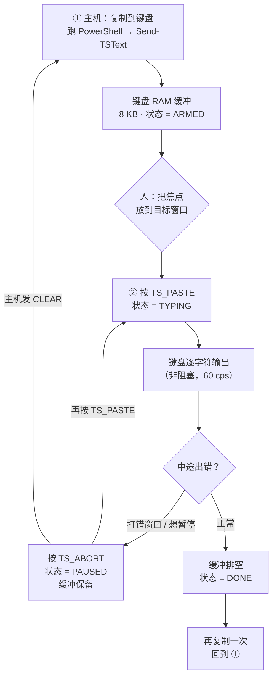
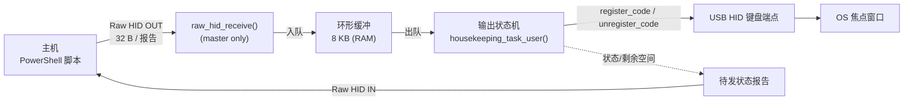
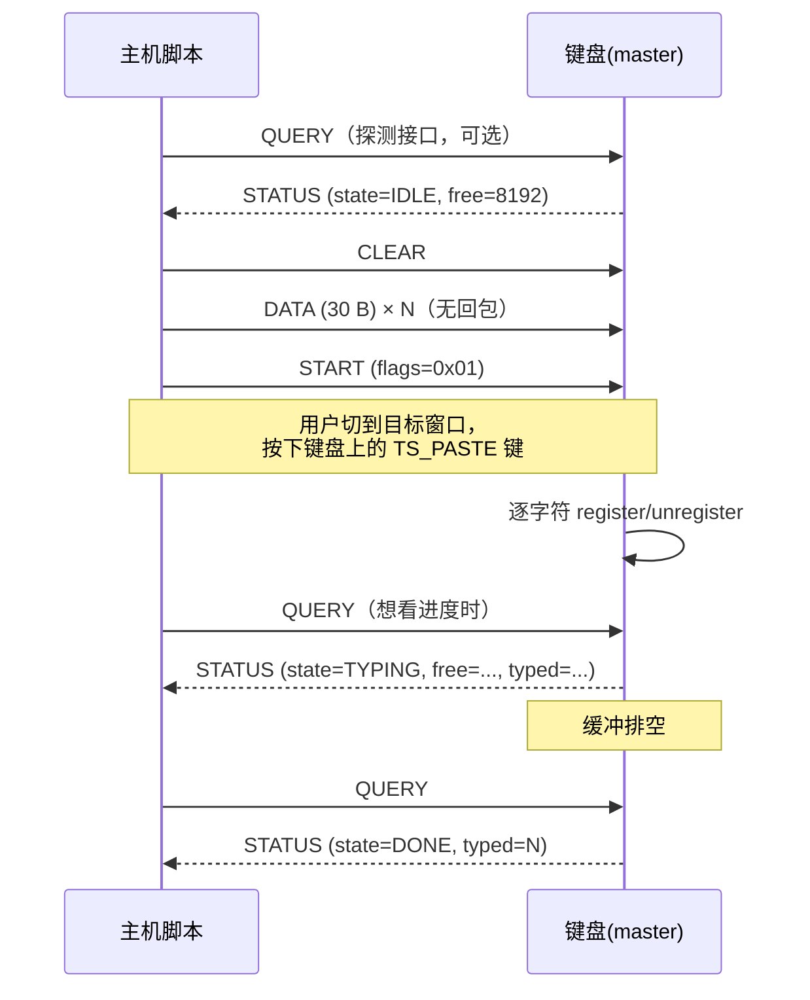
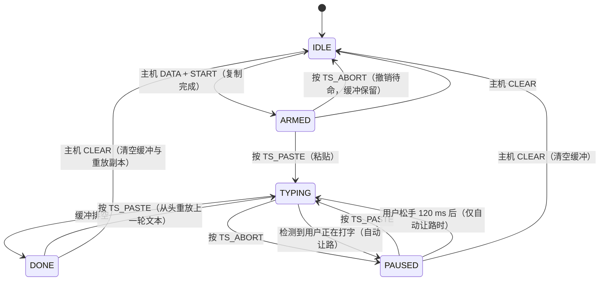
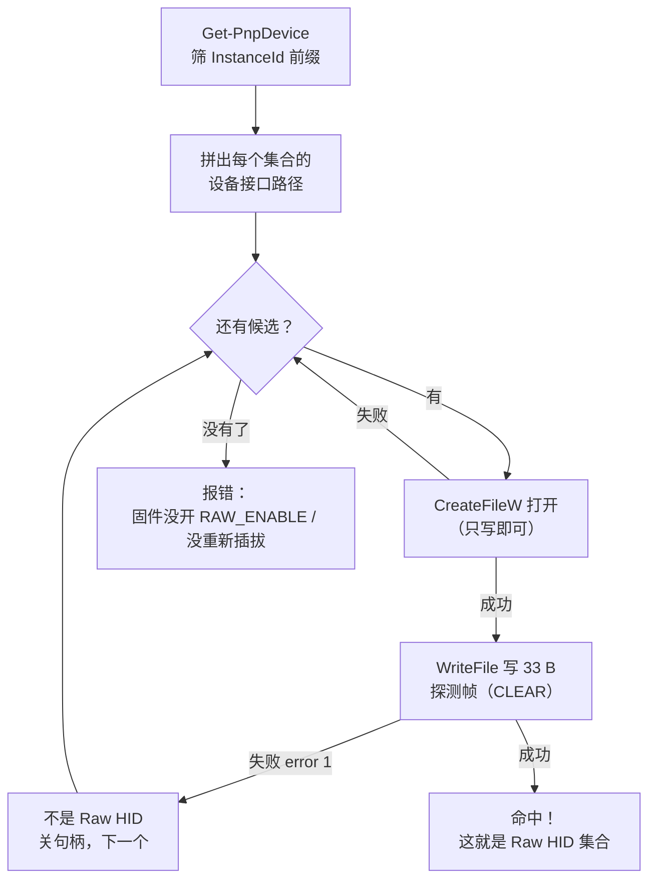
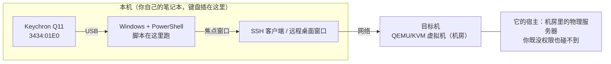

# USB 文本流注入（TextStream）设计文档 v0.25（固件已实现并经真机验证）

> 目标键盘：Keychron Q11（ANSI + Encoder），keymap「two」
> 状态：**固件已实现并编译通过**；**目标机实测确认是 QEMU/KVM 虚拟机、无 USB 直通**，因此主机侧需改在本机跑（§7.12.6）
> 作者备注：协议、键位已定案；部署路线因目标机环境而变更，以本文件为准。

**修订记录**

| 版本 | 变更 |
| --- | --- |
| v0.9 | 初版：Raw HID + 8 KB 环形缓冲 + 两种触发方式 |
| v0.10 | 触发方式收敛为**只做按键触发**（Q1 定案）；主机侧确认 PowerShell 可原生实现 |
| v0.11 | 主机侧改为**不落地脚本、只交付可粘贴代码块**（目标机禁传脚本）；删掉 setupapi/`HidP_*` 与自检脚本，改为 6 个 kernel32 函数；代码块已实测编译+运行 |
| v0.12 | 明确**不使用 VIA**；引入「先复制、后粘贴」心智模型与用户操作图；`TS_TYPE` → `TS_PASTE`，补充 `TS_ABORT` 职责、状态机与键位示意图 |
| v0.13 | 键位定案：`TS_PASTE` = `[1,0]`、`TS_ABORT` = `[5,0]`，均为左侧列的**独立空键**，三层统一取值且不用 tap-hold / OSL，彻底隔离 ctrl / shift / 符号层逻辑 |
| v0.14 | 目标机**无外网**：Python/hidapi 从“可行”改为 **⚠️ 不推荐**（需上传依赖，审计更严）；PowerShell + `kernel32` 成为首选；§7.1 / §9.8 / Q9 同步改为“零上传优先”口径 |
| v0.15 | **修正上传表述**：上传脚本/包并非禁止，而是需走 **OA 审批**；目标机无外网使 `pip install` 不可行。改为“优先零上传，必要时走 OA” |
| v0.16 | **修正根本误解**：文本进入目标机只有「键盘手敲」与「OA 上传」两条路，**没有“粘贴”捷径**（剪贴板内容本身也得先靠这两条进来）。新增 §7.9 主机侧体量控制与手敲自检，新增 Q10（选手敲还是上传）、Q11（固件内嵌脚本 bootstrap） |
| v0.17 | **协议简化**：只有 `QUERY` 回 `STATUS`，其余命令静默 → 主机“只写不读”也安全，并让 A′ 精简版只需 3 个 Win32 函数。新增 §7.10 A′ 精简版（**已在本机实测通过**）；§7.4 补充只写/读写两种探测的实测对比 |
| v0.18 | **固件实现完成并编译通过**：新增 `textstream.c/.h`，`rules.mk` 加 `RAW_ENABLE` + `SRC`，`config.h` 加参数，`keymap.c` 接入两颗键与 `housekeeping_task_user()`。A′ 脚本移到 `docs/`。§6.1/§11 改为“实施状态” |
| v0.19 | 新增 **§7.11 阶梯式验证（L0→L3）**：实测发现“33 B 写成功”会假阳性（本机就是写了但无回包），因此**只有写 `QUERY` 后读回 `0x80` 才能证明链路成立**；新增 `docs/textstream-check.ps1`。另记录两个坑：`Get-PnpDevice` 幽灵节点需 `-PresentOnly`；`OVERLAPPED` 与 `lpNumberOfBytesWritten` 必须配套 |
| v0.20 | 新增 **§7.12 L0 返回空的排查**：逐段解释 L0 命令、给出 4 条独立佐证路径（注册表 / USB 类 / 键盘出身 / 会话身份）与热插拔差分，并列出“键盘不在目标机”时的三条出路（含不需直通的“脚本跑宿主 + VM 窗口前台”） |
| v0.21 | **目标机实测定案（§7.12.6）**：目标机是 **QEMU/KVM**（`i440FX + PIIX`、`SUBSYS_...1AF4`），键盘是模拟 PS/2（`ACPI\PNP0303`），注册表无任何 `VID_3434` 历史 → **Q11 从未直通**。因此脚本应跑在键盘所插的那台本机，焦点对准远程会话 |
| v0.22 | **真机验证通过 + 修正两个主机侧 bug**：① raw HID 有 report ID，缓冲区必须 **33 字节、数据从 index 1 开始**（读 32 会永久超时）；② 必须**先开读句柄再发命令**，否则驱动丢弃 IN 报告。另：纠正“本机=宿主机”的错误拓扑表述 |
| v0.23 | **Shift 丢失修复**：VDI / RDP 会合并或漏采样“只有修饰键”的报告，`aA1!zZ` 被写成 `aa11zz`。带 Shift 的字符改为 `SHIFT(shift_ms) → PRESS → RELEASE → GAP` 四段；新增 `TEXTSTREAM_SHIFT_MS`（默认 50；实测 10 ms 稳定、5 ms 出错）；`SET_DELAY` 改为 `[1..2]=shift_ms`，`press`/`gap` 固定为编译期常量 |
| v0.24 | **键位与重放**：`TS_ABORT` 从 `[5,0]` 移到 `[2,0]`（`TS_PASTE` 正下方）；一轮打完后缓冲**不擦除**，再按一次 `TS_PASTE` 从同一位置重打同一段文本 |
| v0.25 | **主机脚本升级**：`textstream-slim.ps1` 支持 `-File`（任意长度流控）、`-Append`、`-Shift`；接口探测改为 QUERY→STATUS，不再依赖会假阳性的“33 B 写成功” |

---

## 1. 需求

在主机（Windows `cmd` / PowerShell）里运行脚本，把一段文本通过 USB 送进键盘；
键盘**在不重新枚举、不复位、不掉电**的前提下，把这段文本以键盘输入的方式“打”到当前获得焦点的窗口里。

用一句话概括：**主机 → USB → 键盘 RAM 缓冲 → 键盘 HID 输出**。

需求里明确的前置条件：

| 条件 | 设计含义 |
| --- | --- |
| 传输过程中键盘不掉电 | 数据放 **RAM 环形缓冲** 即可，不需要 EEPROM / Flash 持久化 |
| 键盘不重启、不重枚举 | 必须复用现有 USB 连接（不能切 bootloader、不能换 VID/PID） |
| 键盘可以把内容“输出出来” | 用键盘自己的 HID 端点模拟按键（`register_code`），而不是任何 OS 注入 |

### 1.1 非目标（v1 明确不做）

- 键盘 → 主机方向的数据流（只回报状态码，不回报文本）。
- 非 ASCII（含中文、emoji、UTF-8 多字节）文本的直接输入 —— HID 键盘只能在 OS 当前键盘布局下敲 ASCII。
- 掉电保存 / 重启后恢复（RAM 丢了就是丢了）。
- 与 VIA 同时使用（见 §9.1）。**已确认：本机不使用 VIA，`RAW_ENABLE` 独占 `raw_hid_receive`，无需兼容。**
- 实时双向聊天式的流（本文档是“批量投递 + 键盘按序打字”模型）。

### 1.2 心智模型：先「复制」，后「粘贴」

把整件事想成**跨设备的一次复制粘贴**：键盘里有一块 8 KB 的“剪贴板”（RAM 缓冲）。

| 步骤 | 动作 | 谁来做 | 用什么 |
| --- | --- | --- | --- |
| **① 复制** | 把文本写进键盘的缓冲 | 主机 | PowerShell 脚本 → `DATA` / `START` |
| **② 粘贴** | 把缓冲里的文本打进焦点窗口 | 人（按一下键） | 键盘上的 `TS_PASTE` 键 |
| （可选）中断 | 立刻停手，缓冲**不丢** | 人 | `TS_ABORT` 键 |



**与普通复制粘贴的差别**（一句话）：普通粘贴是 OS 把剪贴板塞进去，这里是我们把文本交给键盘、**由键盘自己“打”出来**。所以：

- 文本长度受 **8 KB 缓冲**限制（约 2 分钟打字量），不是无限。
- 速度受**键盘打字节拍**限制（约 60 字符/秒），不是瞬间出现。
- 键盘打出来的字符**和真人敲键完全一样**，任何不接受模拟输入的软件也拦不住；但反过来，**焦点在哪个窗口就打进哪个窗口**，键盘无从得知。

### 1.3 两个用户按键的职责

| 键码 | 名字 | 什么时候用 | 行为 | 缓冲 |
| --- | --- | --- | --- | --- |
| `TS_PASTE` | **粘贴键** | 文本已灌好、想让键盘开始打 | `ARMED`/`PAUSED` → `TYPING`；其它状态按下无动作 | 不动 |
| `TS_ABORT` | **中断键** | 打错窗口、要暂停、发现不对 | `TYPING` → `PAUSED`（立刻停手）；`ARMED` → `IDLE`（撤销待命） | **保留** |
| （无键） | `CLEAR` | 丢弃缓冲、重新来 | 只在主机侧发 `CLEAR` 命令 | **清空** |

三点说明：

- 两颗键都**只响应按下、忽略抬起**，并且 `return false` 把事件吞掉 —— 不会把它们自己打进目标窗口，也不会被 keyrepeat 触发第二次。
- `TS_ABORT` 刻意**不清缓冲**：中断场景几乎都是“等一下再继续”（切个窗口、关掉弹窗），清空是破坏性的，应该由主机脚本显式 `CLEAR`。
- 两颗键各占一个**独立物理空键**（左侧那一列），且**三层都写同一个 keycode**，与当前层无关 —— 这样它们不牵扯 tap-hold / ctrl 层 / 符号层的任何逻辑，详见 §6.6.3。

---

## 2. 硬件与工程约束

| 项 | 值 | 影响 |
| --- | --- | --- |
| MCU | STM32L432（`info.json` 已确认） | 64 KB RAM / 256 KB Flash，8 KB 缓冲绰绰有余 |
| 分体 | `split.enabled = true`，半区走 USART（PA9） | **USB 只在主控（master）半区**，缓冲与输出逻辑必须限定在主控侧 |
| USB | 全速 12 Mbps，HID 轮询 1 ms | 单报告 32 B → 理论上限 ≈ 29 KB/s |
| 现有特性 | RGB Matrix（SNLED27351，I2C 1 MHz）、Encoder Map、Key Override、DIP Switch、Split Watchdog | 不能占用 I2C 带宽/主循环时间的大头 |
| 现有 keymap | 3 层、大量 tap-hold / OSL | 输出必须绕过层解析，避免被 tap-hold 判定污染 |
| QMK 版本 | 2026-10 仓库快照 | 已有 `raw_hid_receive` / `housekeeping_task_user` / `last_input_activity_elapsed()`（已核实） |

---

## 3. 总体架构



数据路径上**没有阻塞等待**：
- `raw_hid_receive()` 只做校验 + 拷贝入队，绝不在里面打字（它跑在 USB 任务上下文，阻塞会拖死 USB）。
- 打字由 `housekeeping_task_user()` 里的非阻塞状态机推进，每轮主循环只推进一步。

---

## 4. 传输层选型

| 方案 | 可行性 | 结论 |
| --- | --- | --- |
| **Raw HID（`RAW_ENABLE`）** | 复用现有 USB 描述符，加一个 HID 接口；Windows 免驱；QMK 官方 API | ✅ 采用 |
| VIA 自定义通道 | 需要 `VIA_ENABLE`，且 `raw_hid_receive` 会被 VIA 占用 | ❌ v1 不用（见 §9.1） |
| `CONSOLE` / CDC | QMK 的 console 只是调试输出（TX），没有通用 CDC 数据通道 | ❌ 不可行 |
| 键盘 LED / 指示灯反向 | 带宽与可靠性都不够 | ❌ |

**Raw HID 关键事实（已在本仓库核实）**

- 报告长度固定 32 B（`tmk_core/protocol/usb_descriptor.h: RAW_EPSIZE 32`）。
- 接口标识：Usage Page `0xFF60`、Usage `0x61`。主机脚本按这个找设备，不用猜接口号。
- Windows + hidapi 写入时，**第一个字节是 report id**，QMK 侧固定用 `0x00`，即主机实际写 33 字节。
- QMK 的 OUT 端点同一时刻只挂一个报告，主机写快了会被 NAK（天然背压）；即便如此，我们仍然做**显式信用流控**，用来给主机反馈“还剩多少空间”。

---

## 5. 协议规范 v1

### 5.1 主机 → 键盘（byte0 = 命令字）

> 下表的 `DATA`+`START` 就是 §1.2 里的**「复制」步骤**；「粘贴」不需要命令，由人按键盘完成。

| CMD | 名称 | 载荷 | 回 `STATUS`？ | 说明 |
| --- | --- | --- | --- | --- |
| `0x01` | `DATA` | `[1]=len (1..30)`，`[2..31]` = 数据 | ❌ | 写入缓冲。空间不足时只写入能放下的部分 |
| `0x02` | `START` | `[1]=flags`（v1 固定 `0x01` = 等按键），`[2..3]` 保留 | ❌ | **「复制」完成** → `ARMED`，等用户按 `TS_PASTE` |
| `0x03` | `ABORT` | — | ❌ | 停止打字，**保留**缓冲 |
| `0x04` | `CLEAR` | — | ❌ | 停止打字并清空缓冲 |
| `0x05` | `QUERY` | — | ✅ | 状态查询，**唯一**会回包的命令 |
| `0x06` | `SET_DELAY` | `[1..2]=shift_ms`（16 位小端，0 = 保持当前值） | ❌ | 运行时调整 Shift 提前量（VDI 链路需要） |

### 5.2 键盘 → 主机（byte0 = `0x80`，固定一帧 `STATUS`）

| 字节 | 含义 |
| --- | --- |
| `[0]` | `0x80` |
| `[1]` | 状态：`0`=IDLE，`1`=ARMED（复制的文本已就绪，等 `TS_PASTE`），`2`=TYPING，`3`=PAUSED，`4`=DONE，`5`=ERROR |
| `[2..3]` | 缓冲剩余空间（LE16，字节） |
| `[4..5]` | 已输出字节数（LE16，低 16 位） |
| `[6]` | 错误码：`0`=无，`1`=缓冲满，`2`=非法字符，`3`=协议错误 |
| `[7..31]` | 保留 `0x00` |

**规则：只有 `QUERY` 回 `STATUS`，其余命令一律不回复。**

这不是省略，而是**必需的设计**：

- QMK 的 `raw_hid_send()` 在 IN 端点忙时会阻塞等待。若主机“只写不读”（如精简版 A′），累积的未读状态帧会卡住固件主循环。
- 只让 `QUERY` 回包后，主机不发 `QUERY` 就完全不会有 IN 数据 → **写-只模式天然安全**，也省掉了主机侧整套读超时代码。
- 流控也不再依赖逐帧 ACK：主机需要时自己 `QUERY` 一次拿到 `free` 即可（见 §7.7）。

### 5.3 交互时序（正常流程）



脚本在发完 `START` 后就关句柄退出，**不等待 `DONE`**（什么时候「粘贴」由人决定，`ARMED` 不超时，`QUERY` 随时可用）。要看进度就重新连一次、发一帧 `QUERY`。

### 5.4 可靠性说明

- USB HID 中断传输本身有 CRC 与硬件重传，单帧不会静默丢失。
- 不额外做序号/重传：一旦发现“丢了一帧”，说明链路已经异常（拔线/挂死），此时最有意义的是报错而不是重传。
- `DATA` 的 `len` 字段同时是完整性检查：`len > 30` 直接判协议错误。

---

## 6. 固件侧设计

### 6.1 文件改动清单（**已实现，编译通过**）

| 文件 | 改动 | 状态 |
| --- | --- | --- |
| `keymaps/two/rules.mk` | `RAW_ENABLE = yes` + `SRC += textstream.c`（**不加** `VIA_ENABLE`） | ✅ |
| `keymaps/two/config.h` | `TEXTSTREAM_BUF_SIZE` / `PRESS_MS` / `GAP_MS` / `IDLE_GUARD_MS` | ✅ |
| `keymaps/two/textstream.h`（新增） | 对外 API：`ts_task()` / `ts_paste()` / `ts_abort()` / `ts_clear()` / `ts_free()` / `ts_pending()` | ✅ |
| `keymaps/two/textstream.c`（新增） | 环形缓冲、协议解析、输出状态机、`raw_hid_receive()` | ✅ |
| `keymaps/two/keymap.c` | ① `process_record_user` 增加 `TS_PASTE` / `TS_ABORT`；② `housekeeping_task_user()` 调用 `ts_task()`；③ 三层 keymap 的 `[1,0]`/`[2,0]` 换成这两颗键 | ✅ |
| `keymaps/two/docs/textstream-design.md` | 本文档 | ✅ |
| `keymaps/two/docs/textstream-slim.ps1` | 主机脚本：`-Text` / `-File`（流控，任意长度）/ `-Append` / `-Shift`；QUERY→STATUS 探测 | ✅ |
| `keymaps/two/docs/textstream-check.ps1` | **可行性检查（L0→L3）**：写 `QUERY` 并等 `STATUS`，唯一不会假阳性的判据 | ✅ |
| `tools/textstream/send.py` | Python + hidapi 版；目标机需上传依赖包，**默认不做** | ❌ 未提供 |

**构建结果**（`qmk compile -kb keychron/q11/ansi_encoder -km two`）：

```
Linking: .build/keychron_q11_ansi_encoder_two.elf    [OK]
text    data     bss     dec     hex filename
57244    1924   63608  122776   1df98 ...
```

> `bss` 63608 里包含 ChibiOS 预留的堆区，**真实静态占用**约 17 KB：
> `ts_buf` = 8192 B（`.bss`，符号 `ts_buf` size 0x2000）＋ 其他全局 ~7 KB ＋ data 1924 B。
> STM32L432 有 64 KB SRAM，余量充足。

### 6.2 数据结构

```c
// 单生产者（raw_hid_receive，主循环/USB 任务上下文）
// 单消费者（housekeeping_task_user，主循环上下文）
// 两者都在主循环上下文里跑 → 不需要关中断
static uint8_t  ts_buf[TEXTSTREAM_BUF_SIZE];
static uint16_t ts_head, ts_tail;   // 单调递增，取模用 & (SIZE-1)，SIZE 必须 2 的幂
static bool     ts_full;            // 用 full 标志区分“满”与“空”

typedef enum {
    TS_IDLE, TS_ARMED, TS_TYPING, TS_PAUSED, TS_DONE, TS_ERROR
} ts_state_t;
```

**内存预算**

| 项 | 大小 |
| --- | --- |
| 环形缓冲（默认） | 8192 B |
| `textstream.c` 状态/计数 | < 32 B（static，`.bss`） |
| 代码段增量（估算） | ≈ 1.5–2 KB Flash |
| Raw HID 子系统 | 已有 core 代码，按 QMK 常规增量 |

STM32L432 有 64 KB RAM，扣除 USB/矩阵/RGB 缓冲后仍非常宽松；`TEXTSTREAM_BUF_SIZE` 允许在 2/4/8/16 KB 间配置，配 `STATIC_ASSERT` 保证是 2 的幂且不超过上限。

### 6.3 主控判定（分体必做）

```c
void raw_hid_receive(uint8_t *data, uint8_t length) {
    if (!is_keyboard_master()) return;   // 从半区没有 USB，直接忽略
    ...
}
```

`raw_hid_send()` 只在主控侧、且只在**应答已收到的帧**时调用，避免脱机时对不存在的端点写包。

### 6.4 输出状态机（核心）

```c
void ts_task(void) {
    // ARMED 什么都不做：只等 process_record_user 里的 TS_PASTE 把状态推到 TYPING
    if (ts_state != TS_TYPING) return;

    // 1) 用户正在打字 → 让路
    if (last_input_activity_elapsed() < TEXTSTREAM_IDLE_GUARD_MS) return;

    // 2) 用户按着修饰键 → 让路（否则会变成快捷键）
    if (get_mods() & (MOD_MASK_CTRL | MOD_MASK_ALT | MOD_MASK_GUI)) return;

    // 3) 两阶段节拍：按 → 放 → 间隔
    switch (ts_phase) {
        case TS_PHASE_PRESS:   /* register_code(...)             */ break;
        case TS_PHASE_RELEASE: /* unregister_code(...)           */ break;
        case TS_PHASE_GAP:     /* 等待 gap_ms 后取下一字节        */ break;
    }
}
```

要点：

1. **不复用 `SEND_STRING`**。`send_string()` / `send_char()` 内部是 `wait_ms` 阻塞实现（见 `quantum/send_string/send_string.c`），会把主循环卡住几十毫秒，RGB 动画和矩阵扫描都会抖。自己写的两阶段节拍只占几个 `if`。
2. **ASCII → 键码直接复用 QMK 的 LUT**：`ascii_to_keycode_lut[]` / `ascii_to_shift_lut[]` / `ascii_to_altgr_lut[]`（`send_string.h` 里 `extern`，已核实存在）。不重复造表，也保证与 `SEND_STRING` 行为一致（US 布局）。
3. **特殊字符**：`\n` → `KC_ENT`；`\r` 直接丢弃（避免 CRLF 打两下回车）；`\t` → `KC_TAB`；`0x00` 视为协议填充，跳过。
4. **非 ASCII（≥0x80）**：跳过并累加 `bad_bytes` 计数，最终在 `STATUS.error=2` 里体现，不静默吞掉。
5. **Shift 处理**：需要 Shift 时拆成 `SHIFT(shift_ms) → PRESS(press_ms) → RELEASE(gap_ms) → GAP(gap_ms)` 四段：先单独按下 `KC_LSFT` 并保持 `shift_ms`，再按字符键，松开字符键后再保持 `gap_ms` 才松 Shift。**必须单独提前**：本机上同帧就够，但 RDP / VDI 会合并或漏采样“只有修饰键”的报告（实测表现为大写变小写、`!` 变 `1`）。AltGr 字符（US 布局里没有）直接判非法。
6. **层无关**：用的是 `register_code()`（基础键码直通），不经过 `keymaps[]` 解析，所以当前在哪一层、tap-hold 是否在判定中，都不会改变输出内容。

### 6.5 时间参数（默认值）

| 宏 | 默认 | 说明 |
| --- | --- | --- |
| `TEXTSTREAM_PRESS_MS` | 5 | 按下保持时长；必须 > USB 1 ms 轮询 |
| `TEXTSTREAM_GAP_MS` | 10 | 字符间隔；66 cps。cmd / VSCode 实测最稳 |
| `TEXTSTREAM_SHIFT_MS` | 50 | Shift 提前量；VDI 实测 10 ms 稳定、5 ms 出错，取 50 留余量（可用 `SET_DELAY` / `-Shift` 覆盖） |
| `TEXTSTREAM_IDLE_GUARD_MS` | 120 | 最近 120 ms 内有物理按键 → 暂停输出 |
| `TEXTSTREAM_BUF_SIZE` | 8192 | 环形缓冲 |

吞吐估算：单字符 ≈ `5 + 10 = 15 ms`（带 Shift ≈ `20 + 5 + 10 + 10 = 45 ms`）→ **约 66 / 22 字符每秒**，8 KB ≈ 2–6 分钟连续文本。
主机侧写入能力 ≈ 29 KB/s，远大于消费速度，所以**流控是必需的**，不是优化项。

### 6.6 用户按键：`TS_PASTE` / `TS_ABORT`（已确认）

#### 6.6.1 状态机



状态与触发条件对照：

| 状态 | 键盘在做什么 | 进入条件 | 退出条件 |
| --- | --- | --- | --- |
| `IDLE` | 空闲 | 上电 / `CLEAR` / `ABORT`（从 `ARMED`） | 收到 `START` |
| `ARMED` | 缓冲已满，等命令 | `START` | `TS_PASTE`（→`TYPING`）/ `TS_ABORT` 或 `CLEAR`（→`IDLE`） |
| `TYPING` | 逐字符输出 | `TS_PASTE` | 排空（→`DONE`）/ `TS_ABORT` 或用户输入（→`PAUSED`） |
| `PAUSED` | 停手，缓冲保留 | `TS_ABORT` / 自动让路 | `TS_PASTE` 或让路条件消失（→`TYPING`）/ `CLEAR`（→`IDLE`） |
| `DONE` | 全部打完，缓冲内容仍保留 | 缓冲排空 | `TS_PASTE`（→`TYPING`，从头重放）/ `CLEAR` / 新的 `START` |
| `ERROR` | 协议错误 | 非法命令 / 越界 | `CLEAR` |

#### 6.6.2 实现

```c
case TS_PASTE:   // 粘贴：让缓冲里的文本开始"打"出来
    if (record->event.pressed) {
        if (ts_state == TS_ARMED || ts_state == TS_PAUSED) {
            ts_state = TS_TYPING;   // 非阻塞：ts_task() 下一轮开始吐字符
        } else if (ts_state == TS_DONE) {
            ts_paste();             // 从头重放：tail 回退到上一轮起点，数据本来就没被擦
        }
        // IDLE / TYPING 下按下 = 无动作
    }
    return false;    // 吞掉事件，绝不把自己打进目标窗口

case TS_ABORT:   // 中断：立刻停手，缓冲保留
    if (record->event.pressed) {
        if (ts_state == TS_TYPING) {
            ts_state = TS_PAUSED;   // 还能按 TS_PASTE 续打
        } else if (ts_state == TS_ARMED) {
            ts_state = TS_IDLE;     // 撤销待命，避免误触发
        }
    }
    return false;
```

要点：

- **零焦点竞态**。什么时候开始完全由人决定，不需要倒计时。
- **缓冲可以先灌满、放很久**。`ARMED` 不超时，数据在 RAM 里等着。
- **两键都只认 `pressed`**，抬起忽略（避免 keyrepeat 把一次长按当成多次）。
- **两键都 `return false`**，事件被吞掉，不会往目标窗口多打一个字符。
- `TS_ABORT` 与"自动让路"共用 `PAUSED` 状态，但恢复方式不同：手动中断要**再按一次 `TS_PASTE`**，自动让路是**松手 120 ms 后自己续**（见 §6.4）。

#### 6.6.3 键位：两颗**独立空键**（已确认）

按你的要求，两颗键各占键盘左侧那一列的两个**独立物理键**，不挂在 ctrl / shift / 符号层上，也不用 tap-hold 或 OSL 包裹：

```
        ┌─────────┐
        │  Mute   │  [0,0]  左上旋钮按下（各层 Mute，符号层 QK_BOOT）
        ├─────────┤
        │TS_PASTE │  [1,0]  ← 粘贴键 / 重放键（三层都写 TS_PASTE）
        ├─────────┤
        │TS_ABORT │  [2,0]  ← 中断键（三层都写 TS_ABORT）
        ├─────────┤
        │         │  [3,0]  空
        ├─────────┤
        │         │  [4,0]  空
        ├─────────┤
        │         │  [5,0]  空（原中断键位置，v0.24 移走）
        └─────────┘
           左侧那一列（第 0 个键位）
```

| 键码 | 位置 | 三层统一取值 | 说明 |
| --- | --- | --- | --- |
| `TS_PASTE` | `[1,0]`（Caps 左边那一格，旋钮正下方） | `TS_PASTE` | 复制完随手就能按；打完再按一次 = 重放 |
| `TS_ABORT` | `[2,0]`（粘贴键正下方） | `TS_ABORT` | 贴着粘贴键，出事时一只手就能停 |

已核对当前 keymap：这两格在 `INPT_L` / `CTRL_L` / `SYB1_L` 三层里**都是 `XXXXXXX`**，改动不触碰任何字符键（物理上它们就是那两个没有丝印的空键）。

**为什么这样不会出"奇怪 bug"** —— 关键是让它们完全不参与其他机制：

| 会出问题的写法 | 本方案怎么避开 |
| --- | --- |
| 用 `LT(层, TS_PASTE)` / `MT(修饰, TS_PASTE)` | ❌ 不用，就是**裸 keycode**：没有 tapping term、没有 `hold_on_other_key_press` 判定 |
| 用 `OSL` 进入后再按 | ❌ 不用：不依赖 F 键、不依赖 `ONESHOT_TIMEOUT` |
| 只在默认层定义，切层后失效 | ❌ **三层都写同一个 keycode**，与当前层状态无关（不读 `layer_state`） |
| 借字符键当触发键 | ❌ 物理独立键，不与任何字符共用 |
| 按键时顺手注册修饰键 | ❌ 处理函数只改 `ts_state`，不 `register_code` 任何东西 |

另外两点：

- `TS_PASTE` 与 `TS_ABORT` **上下相邻**（`[1,0]` / `[2,0]`），都在左侧一列、远离主键区，日常打字碰不到。
- 两键都在三层里生效，所以哪怕糊里糊涂停在 ctrl 层或符号层，中断键依然一按就停 —— 应急键必须无条件可用。

> `TS_CLEAR` 不占键，只在主机侧发 `CLEAR` 命令。

改动前的实际值（已逐个核对）：`[1,0]` / `[2,0]` / `[5,0]` 在 `INPT_L` / `CTRL_L` / `SYB1_L` 三层里都是**空**——

| 位置 | `INPT_L` | `CTRL_L` | `SYB1_L` |
| --- | --- | --- | --- |
| `[1,0]` | `XXXXXXX` | `XXXXXXX` | `XXXXXXX` |
| `[2,0]` | `XXXXXXX` | `XXXXXXX` | `XXXXXXX` |
| `[5,0]` | `XXXXXXX` | `XXXXXXX` | `XXXXXXX` |

所以改动只是把这几个 `XXXXXXX` 换成 2 个 keycode（其余恢复为空），**不碰到任何字符键、不影响现有三层行为**。

KLE 存档 `docs/keychron-q11-two.json` 也已同步：`[1,0]` 的图例是 `TS:PASTE`、`[2,0]` 是 `TS:ABORT`。

### 6.7 缓冲状态的可视化（可选，建议 v2）

- v1：不做任何指示（`STATUS` 里能查到状态）。
- v2 备选：缓冲非空时让 RGB 出一个低速呼吸的角标；或借用 Caps Lock LED 做“有数据/正在打”的双闪。
  代价：要改 RGB 渲染或与 `CAPS_LOCK_LED_INDEX` 抢灯，建议等 v1 稳定后再加。

### 6.8 与现有 keymap 的相互作用

| 现有特性 | 影响 | 缓解 |
| --- | --- | --- |
| tap-hold（`SPC_CTRL` 等） | 只对物理按键生效；生成键走 `register_code`，不受影响 | 无需处理 |
| OSL 符号层 / `ONESHOT_TIMEOUT` | 生成键绕过层，层状态不变 | 无需处理 |
| Key Override（Shift+BSPC=DEL） | `register_code` 不经过 key override，生成的 BSPC 不会被改写 | 记录在文档（**这是有意为之**） |
| DIP Switch 拦截 | 不涉及 | 无需处理 |
| `QK_BOOT`（符号层左上旋钮） | 打字过程中误触会进 bootloader，缓冲全丢 | 文档提示；v2 可在 `TS_TYPING` 时屏蔽 `QK_BOOT` |
| RGB Matrix | 主循环多几个 `if`，可忽略 | 无需处理 |
| Split Watchdog / USART | 缓冲只在主控侧，半边按键照常同步 | `is_keyboard_master()` 守卫 |

---

## 7. 主机侧交互设计

### 7.1 部署约束：文本进入目标机只有两条路

> **先纠正一个之前的误解（v0.16）**：「粘贴一段代码进 PowerShell」**不是**一条独立的获取途径。
> 剪贴板里的内容本身也得先进入目标机 —— 而在隔离环境里，**把文本送进目标机只有两种方式**：
>
> 1. **键盘手敲**（零上传，但纯人工、易错、几十行很难敲对）
> 2. **OA 上传**（上传文件/包，走审批与审计）
>
> 所以"可粘贴代码块"的真实含义是：**代码必须由你手敲进去**，然后它会留在当前会话里可以反复调用；它省掉的是"重复敲"，不是"第一次敲"。

目标机的其它既有事实：

| 事实 | 影响 |
| --- | --- |
| 上传脚本/包需走 **OA 审批 / 审计** | 可以上传，但每次都要审批 → **能少传就少传** |
| **没有外网** | `pip install` / `npm install` 在线安装**不可行** |
| 上传第三方依赖包 | 审计更严格，不推荐 |

由此得到主机侧的两条可选路线（**没有第三条"粘贴"捷径**）：

| 路线 | 做法 | 代价 |
| --- | --- | --- |
| **A. 手敲**（零上传） | 把 §7.5 的代码**逐字敲进** PowerShell 会话 | 纯人工；实测 **76 行 / 4453 字符**，几乎不可行 → 见下方精简版 |
| **A′. 主机脚本**（§7.10，已实测） | `textstream-slim.ps1`：支持 `-Text` / `-File`（流控） | ✅ 在键盘所插的本机跑；任意长度、可查状态 |
| **B. OA 上传** | 把 §7.5 的代码存成 `textstream.ps1` 上传，`powershell -ExecutionPolicy Bypass -File` 运行 | 走一次审批；但只有**一个纯文本文件、零依赖**，审计负担在所有上传物里最轻 |

**设计含义（重要）**：既然路线 A 的成本与**代码行数**成正比，主机侧代码就必须**尽可能短**。
所以本设计把"聪明"全部放进固件（`textstream.c`），主机侧只保留"搬字节"的最低限度逻辑 —— 详见 §7.9「主机侧体量控制」。

两条路线的共同前提（已实测）：

- **执行策略**：`ExecutionPolicy` 只约束 `.ps1` 文件。路线 A 不受影响；路线 B 用 `-ExecutionPolicy Bypass` 启动进程即可，不需要改系统策略（目标机 5 个作用域均为 `Undefined`）。
- **编码**：路线 B 的 `.ps1` 请存成 **UTF-8 with BOM**（PS 5.1 对无 BOM 文件按 ANSI 码页解码，中文注释会乱）；路线 A 不涉及。

### 7.2 语言选型与实测结论

| 方案 | 依赖 | 可行性 | 结论 |
| --- | --- | --- | --- |
| PowerShell + `Add-Type` P/Invoke `kernel32` | **零**（系统自带 .NET） | ✅ 已实测通过 | **采用** |
| PowerShell + `[IO.FileStream]` 直接开 HID 路径 | 零 | ❌ 不可行 | .NET 明确拒绝非磁盘设备，见下 |
| Python + `hidapi` | 需 `pip install hidapi` | ⚠️ **需上传依赖，不推荐** | 目标机无外网 → 无法在线装；只能下载 wheel 一并走 OA 上传，**审计更严**。仅在“已经批准上传、且不想手敲协议调试代码”时才考虑 |
| PowerShell + WMI/`Get-PnpDevice` 收发数据 | 零 | ❌ | 只能枚举，不能读写报告 |
| PowerShell + WinRT `HumanInterfaceDevice` | 零 | ⚠️ | PS 5.1 无 WinRT 投影 |

> **约束提醒**：目标机无外网 + 上传走 OA。选型的第一原则不是"哪种更优雅"，而是**"代码要敲多长 / 上传物要多大"** —— 零依赖的 PowerShell + `kernel32` 两头都最优：手敲时只需几十行、上传时只是一个纯文本文件。

**实测发现（本机 PS 5.1 + 真实 Q11）**：

1. **`[IO.FileStream]::new('\\?\hid#...', ...)` 不行**。.NET 会报“要求 FileStream 打开一个不是文件的设备”，并提示改用 `CreateFile` + `FileStream(IntPtr)`。所以必须自己 P/Invoke `CreateFileW`。
2. **`CreateFileW` 打开 HID 集合受“读/写”权限影响，这点很关键**：用 `GENERIC_READ|GENERIC_WRITE` 打开时，键盘（`MI_00`、`...COL04`）与鼠标（`...COL01`）集合返回 `Access denied`（系统独占**读**）；但只用 `GENERIC_WRITE` 时 5 个集合全部能打开。所以不能靠“拒绝访问”筛接口，要靠“写 33 B 输出报告是否成功”——详见 §7.4。
3. **overlapped 读超时可用**：`ReadFile` 返回 `ERROR_IO_PENDING (997)` 后 `WaitForSingleObject(event, ms)` 得到 `WAIT_TIMEOUT (258)` → `CancelIo`，实测 400 ms 准时返回，脚本不会被挂死。
4. **不需要 `setupapi.dll` / `HidP_*`**：设备路径可直接由 `Get-PnpDevice` 的 `InstanceId` 拼出，实测与 SetupAPI 枚举出的路径**字节级一致**；usage page 用“发一帧 `QUERY` 看谁回应”来判定，省掉整个 HID 解析层。

所以最终只需 6 个 Win32 函数：

| 函数 | DLL | 用途 |
| --- | --- | --- |
| `CreateFileW` | kernel32 | 打开 HID 设备路径（`FILE_FLAG_OVERLAPPED`） |
| `ReadFile` / `WriteFile` | kernel32 | 32 B 报告收发（写时前置 `0x00` report id） |
| `GetOverlappedResult` | kernel32 | 取回异步结果 |
| `CreateEvent` / `WaitForSingleObject` | kernel32 | 实现读超时 |
| `CancelIo` | kernel32 | 超时后取消未完成 IO |
| `CloseHandle` | kernel32 | 收尾 |

（对比：用 `setupapi` + `hid.dll` 的方案需要 8 个函数 + 3 个结构体，代码量翻倍，而收益只是多拿到 usage page。）

### 7.3 目标机确认清单（手动执行，无需管理员）

目标机实测结果（详见 `实测目标机.md`）：

| 检查项 | 命令 | 目标机实测 | 判定 |
| --- | --- | --- | --- |
| PowerShell 版本 | `$PSVersionTable` | `5.1.17763`（Desktop） | ✅ ≥ 5.1 |
| 进程位数 | `[Environment]::Is64BitProcess` | `True` | ✅ |
| 执行策略 | `Get-ExecutionPolicy -List` | 5 个作用域全 `Undefined` | ✅ 手敲不受限；上传 `.ps1` 时加 `-ExecutionPolicy Bypass` 即可 |
| `hid.dll` | `Test-Path "$env:SystemRoot\System32\hid.dll"` | `True` | ✅ |
| `setupapi.dll` | `Test-Path "$env:SystemRoot\System32\setupapi.dll"` | `True` | ✅（本方案其实用不到） |
| Add-Type 可否编译 C# | 跑 §7.3 末尾那一行 | 本机 `csc.exe v4.0.30319` 可用 | ✅（需在目标机再确认一次） |

上表前 5 项已确认；**唯一还需要在目标机跑一次的是“Add-Type 能否编译”**，因为那依赖 `Microsoft.NET\Framework64\v4.0.30319\csc.exe` 是否存在（极少数精简版系统会缺）。这是**一行**，手敲无压力：

```powershell
# 在目标机上只需这一行就能确认 Add-Type 是否可用（不写文件、不需管理员）
Add-Type -TypeDefinition 'public static class P{ public static int X(){return 42;} }' -PassThru | Select-Object -ExpandProperty Name
# 输出 P 即通过
```

关于权限与上传的明确结论：

| 操作 | 需要管理员？ | 要动上传/审批吗？ |
| --- | --- | --- |
| `Add-Type` 现场编译 C#（P/Invoke 声明） | ❌ | ❌（不产生上传物） |
| `CreateFileW` 打开 Raw HID 集合、`ReadFile`/`WriteFile` 收发 | ❌（普通用户可读写 HID） | ❌ |
| `Get-PnpDevice` 枚举设备 | ❌ | ❌ |
| **手敲代码进交互式会话** | ❌ | ❌（**唯一的零上传途径**） |
| 上传 `.ps1` 脚本文件 | 视策略 | ✅ 走 OA（可选，但比手敲可靠） |
| 上传第三方依赖（wheel / pip / exe / 驱动） | 或许 | ✅ 走 OA，**且审计更严** |
| 在线 `pip install` | — | 🚫 **不可行**（目标机无外网） |
| 写驱动 / 改注册表 / 装服务 | ✅ | ✅ |

> 注意 `Add-Type` 的行为：它在**内存中**编译 C#，产物是一个临时程序集。编译过程的中间文件由 `csc.exe` 放在 `%TEMP%`，**不会在工作目录留下 `.ps1` / `.dll` / `.exe`，也不需要安装任何包**。所以它本身不触发上传/审批。
> 若目标机连 `%TEMP%` 写权限都受限，`Add-Type` 会失败 —— 那就只能改为 OA 上传 `.ps1`（见 Q10）。

### 7.4 设备发现与接口探测（原理）

#### 7.4.1 先理解：一个键盘在 Windows 上是"一堆句柄"

插上一个键盘，Windows 不会给你"一个设备"，而是把它拆成若干 **HID 集合（top-level collection）**：

- USB **接口**（Interface）用 `MI_00` / `MI_01` 区分 —— 这是描述符里真正的接口；
- 同一个接口里的 **collection** 用 `COL01`…`COL04` 区分 —— 这是 report descriptor 里 `COLLECTION(Application)` 的编号。

所以 `3434:01E0` 现在会裂成 5 个集合：

```
3434:01E0
├─ MI_00                → 键盘（boot keyboard，带 report ID）
└─ MI_01
   ├─ COL01             → 鼠标
   ├─ COL02             → 厂商自定义 / 系统控制之类
   ├─ COL03             → Consumer（媒体键等）
   └─ COL04             → 键盘（NKRO）
```

**每一个集合在系统里都是一个独立的设备接口路径（symbolic link）**，`CreateFile` 要打开的正是它：

```
\\?\hid#vid_3434&pid_01e0&mi_01&col03#8&20434ca7&0&0002#{4d1e55b2-f16f-11cf-88cb-001111000030}
└┬┘ └──────────┬──────────────┘ └────────┬────────┘ └──────────────┬─────────────┘
 │              │                        │                        │
 │       接口+集合标识              这个"实例"的唯一后缀      HID 接口类 GUID
 │   （哪块设备、哪个集合）      （同一个型号插两把也不一样）   （固定值，永远不变）
 └─ 走 Win32 设备路径的固定前缀
```

拼法就是把 `Get-PnpDevice` 给的 `InstanceId` 里的 `\` 换成 `#`，前面加 `\\?\`，后面追加 `#` + GUID：

```powershell
$HID_GUID = '{4d1e55b2-f16f-11cf-88cb-001111000030}'
Get-PnpDevice | Where-Object InstanceId -like 'HID\VID_3434&PID_01E0*' | ForEach-Object {
    '\\?\' + ($_.InstanceId.ToLower() -replace '\\', '#') + "#$HID_GUID"
}
```

这样做的价值：**不需要 `setupapi.dll`**。`SetupDiGetClassDevs` + `SetupDiEnumDeviceInterfaces` + `SetupDiGetDeviceInterfaceDetail` 那一套（3 个函数、2 个结构体、约 80 行）干的就是同一件事 —— 把这个路径给你。我们直接拼，省掉整层。

#### 7.4.2 真正的难点：想筛的那个集合，"筛的条件"拿不到

我们要的是 **Raw HID** 集合（UsagePage `0xFF60`、Usage `0x61`），这是 QMK 的 `raw_hid_receive()` 对应的接口。问题在于：

| 想知道 | 怎么拿 | 矛盾 |
| --- | --- | --- |
| 是不是 3434:01E0 | `Get-PnpDevice` 的 InstanceId | ✅ 能拿到 |
| 是哪个接口/集合 | 同上（`MI_xx`/`COLxx`） | ✅ 能拿到 |
| **UsagePage / Usage** | 只有 `HidP_GetCaps()` 能给 | ❌ **必须先有句柄才能调** |
| 路径 | 设备接口枚举 | ✅ 能拼出来 |

于是形成一个死循环：**想按 usage 筛选，必须先打开它；但打开之前不知道哪个该开。**

（`Get-PnpDevice` 的名字也没用：`COL02`/`COL03` 在设备管理器里可能都叫"符合 HID 标准的设备"，看不出 usage page。）

#### 7.4.3 破局：不看"身份证"，看"能不能干活"

既然拿不到描述，就**用行为区分**。关键事实是：**HID 驱动对写入长度是严格校验的**。

Windows 的 `WriteFile` 要求写入缓冲长度 **恰好等于该集合的 `OutputReportByteLength` + 首字节 report ID**。各集合实测：

| 集合 | report descriptor 里的输出报告 | `OutputReportByteLength` | 写 33 字节的结果 |
| --- | --- | --- | --- |
| 键盘（`MI_00`） | 1 个 LED 字节，**带** report ID | 2（1 ID + 1 数据） | ❌ `ERROR_INVALID_FUNCTION (1)` |
| 鼠标（`COL01`） | 没有输出报告 | 0 | ❌ 错误 1 |
| Consumer（`COL03`） | 没有输出报告 | 0 | ❌ 错误 1 |
| **Raw HID** | 32 字节，**不带** report ID | **32** | ✅ **成功（0）** |

- 长度不符 → 驱动在**投递前**就拒绝，返回 `ERROR_INVALID_FUNCTION (1)`；
- 所以写失败**没有任何副作用**（不会往键盘/鼠标发垃圾报告）；
- 而只有 Raw HID 是 32 字节，于是"33 字节写成功"就是一个**唯一指纹**。

> 为什么是 33 而不是 32？`RAW_EPSIZE = 32`（见 `tmk_core/protocol/usb_descriptor.h`），而 QMK 的 raw HID 描述符里**没有 `REPORT_ID` 项**（其它集合都有 `HID_RI_REPORT_ID`）。Windows 的约定是"缓冲首字节永远是 report ID"，没有 report ID 的集合就填 `0x00` 占位 → 32 + 1 = 33。这也是 QMK/hidapi 生态里 `h.write(b'\x00' + data)` 的由来。

#### 7.4.4 探测流程



两种探测强度，对应两个版本的主机脚本：

| 方式 | 做什么 | 能确认什么 | 用在 |
| --- | --- | --- | --- |
| **只写** | 写 33 B `CLEAR`，看是否成功 | 这个集合接受 32 B 输出报告 | A′（§7.10，3 个 Win32 函数） |
| **写 + 读** | 写 `QUERY`，300 ms 内读回 `[0]==0x80` | 上面那条 **＋ 固件真的在跑** | 完整版（§7.5） |

只写足够定位接口，但区分不了"有 Raw HID 接口"和"我们的固件真的在处理它"。完整版多读一帧，等于让固件"答到"。

#### 7.4.5 对真实 Q11 的实测（固件尚未开 `RAW_ENABLE`）

| 集合 | 读写打开 | 只写打开 | 写 33 B |
| --- | --- | --- | --- |
| `MI_00`（键盘） | ❌ 拒绝访问 | ✅ | ❌ 错误 1 |
| `MI_01&COL01`（鼠标） | ❌ 拒绝访问 | ✅ | ❌ 错误 1 |
| `MI_01&COL04`（键盘） | ❌ 拒绝访问 | ✅ | ❌ 错误 1 |
| `MI_01&COL02` | ✅ | ✅ | ❌ 错误 1 |
| `MI_01&COL03` | ✅ | ✅ | ❌ 错误 1 |
| **Raw HID（刷固件后才出现）** | ✅ | ✅ | ✅ 0 **（预期，待真机确认）** |

**一个必须记住的坑**：只有 `GENERIC_READ|GENERIC_WRITE` 打开时，键盘/鼠标集合才返回 `Access denied`（系统独占的是**读**）。一旦改成 `GENERIC_WRITE`（A′ 就是这么做的），5 个集合**全部能打开**。
所以 **A′ 不能靠 "Access denied" 过滤**，只能靠"写 33 B 成功"。这一点早期版本是错的，v0.17 已修正。

#### 7.4.6 为什么这样写不会"硬编码坏掉"

| 场景 | 行为 |
| --- | --- |
| 刷入带 `RAW_ENABLE` 的固件 | 集合从 5 个变成 6 个，多出来的那个写 33 B 成功 → **自动命中，代码不用改** |
| 换 PID（例如刷成另一个键盘） | 只需改筛选前缀（或干脆不筛 VID/PID，全枚举） |
| 同时插两把同样的键盘 | 路径里的实例后缀不同，各自独立；脚本命中**先枚举到的那个**，需要指定就把 `$G` 换成按序列号匹配 |
| 拔掉键盘 | `Get-PnpDevice` 可能仍列出旧条目（非 present），但 `CreateFileW` 会失败 → 直接跳过，无副作用 |
| 键盘被别的程序占用（例如 VIA） | 读写打开失败 → 跳过；但我们不用 VIA（§9.1），不存在这个冲突 |

**成本对比**：这条路只需 `Get-PnpDevice` + `CreateFileW` + `WriteFile`，共 3 个调用；用 SetupAPI + `HidP_GetCaps` 则需要 8 个函数 + 3 个结构体。差别就是"能不能手敲进去"。

### 7.5 完整版主机代码（供 OA 上传，含状态查询与流控）

**定义段**（存成 `textstream.ps1` 运行；或手敲进交互式会话）。

> **体量实测：76 行（非空）/ 4453 字符** → 手敲不现实，建议走 OA。
> 主机脚本看 §7.10 的 `textstream-slim.ps1`（**已在本机跑通**，支持文件输入与流控）。

```powershell
Add-Type -TypeDefinition @'
using System; using System.Runtime.InteropServices;
public static class TS {
  [StructLayout(LayoutKind.Sequential)] public struct OL { public IntPtr A,B,C,D,E; }
  [DllImport("kernel32",CharSet=CharSet.Unicode,SetLastError=true)] static extern IntPtr CreateFileW(string n,uint a,uint s,IntPtr sec,uint d,uint f,IntPtr t);
  // 写句柄是同步的 → 字节数用 out int；读句柄是 OVERLAPPED 的 → 字节数必须传 NULL（§7.11 坑 2）
  [DllImport("kernel32",SetLastError=true)] static extern bool WriteFile(IntPtr h,byte[] b,int n,out int w,IntPtr o);
  [DllImport("kernel32",SetLastError=true)] static extern bool ReadFile(IntPtr h,byte[] b,int n,IntPtr r,ref OL o);
  [DllImport("kernel32",SetLastError=true)] static extern bool GetOverlappedResult(IntPtr h,ref OL o,out int n,bool w);
  [DllImport("kernel32",SetLastError=true)] static extern IntPtr CreateEvent(IntPtr a,bool m,bool i,string n);
  [DllImport("kernel32",SetLastError=true)] static extern uint WaitForSingleObject(IntPtr h,uint ms);
  [DllImport("kernel32")] static extern bool CancelIo(IntPtr h);
  [DllImport("kernel32")] static extern bool CloseHandle(IntPtr h);
  static IntPtr hw=(IntPtr)(-1), hr=(IntPtr)(-1);
  public static int OpenW(string p){ CloseAll(); hw=CreateFileW(p,0x40000000,3,IntPtr.Zero,3,0,IntPtr.Zero);
    return hw==(IntPtr)(-1) ? Marshal.GetLastWin32Error() : 0; }
  public static int OpenR(string p){ hr=CreateFileW(p,0x80000000,3,IntPtr.Zero,3,0x40000000,IntPtr.Zero);
    return hr==(IntPtr)(-1) ? Marshal.GetLastWin32Error() : 0; }
  public static int Write(byte[] d){ var b=new byte[33]; Array.Copy(d,0,b,1,Math.Min(32,d.Length));
    int w; return WriteFile(hw,b,33,out w,IntPtr.Zero) ? 0 : Marshal.GetLastWin32Error(); }
  public static byte[] Read(int ms){
    var b=new byte[33]; IntPtr ev=CreateEvent(IntPtr.Zero,true,false,null);
    var o=new OL(); o.E=ev;
    bool ok=ReadFile(hr,b,33,IntPtr.Zero,ref o);
    int e=Marshal.GetLastWin32Error();
    if(!ok){
      if(e!=997){ CloseHandle(ev); return null; }
      if(WaitForSingleObject(ev,(uint)ms)!=0){ CancelIo(hr); CloseHandle(ev); return null; }
      int got; if(!GetOverlappedResult(hr,ref o,out got,false)){ CloseHandle(ev); return null; }
    }
    CloseHandle(ev); return b; }
  public static void CloseAll(){
    if(hw!=(IntPtr)(-1)){ CloseHandle(hw); hw=(IntPtr)(-1); }
    if(hr!=(IntPtr)(-1)){ CloseHandle(hr); hr=(IntPtr)(-1); } }
}
'@

$TS_GUID = '{4d1e55b2-f16f-11cf-88cb-001111000030}'

function Connect-TS {
    foreach ($d in Get-PnpDevice -PresentOnly | Where-Object InstanceId -like 'HID\VID_3434&PID_01E0*') {
        $p = '\\?\' + ($d.InstanceId.ToLower() -replace '\\', '#') + "#$TS_GUID"
        if ([TS]::OpenW($p) -ne 0) { continue }
        if ([TS]::OpenR($p) -ne 0) { [TS]::CloseAll(); continue }   # ⚠ 必须先开读句柄，再写（§7.12.7）
        if ([TS]::Write([byte[]](5,0)) -ne 0) { [TS]::CloseAll(); continue }
        $r = [TS]::Read(300)
        if ($r -and $r[1] -eq 0x80) { $script:TS_PATH = $p; "connected: $p"; return $true }
        [TS]::CloseAll()
    }
    'TextStream interface not found (firmware RAW_ENABLE? replugged?)'; return $false
}

function Get-TSStatus {
    if ([TS]::Write([byte[]](5,0)) -ne 0) { return $null }
    $r = [TS]::Read(500); if (-not $r) { return $null }
    # ⚠ 数据从 index 1 开始（index 0 是 report ID）
    [pscustomobject]@{
        State = 'IDLE ARMED TYPING PAUSED DONE ERROR'.Split(' ')[$r[2]]
        Free  = [BitConverter]::ToUInt16($r, 3)
        Typed = [BitConverter]::ToUInt16($r, 5)
        Error = $r[7]
    }
}

function Send-TSText {
    param([string]$Text, [int]$Chunk = 30)
    if ($Text -match '[^\x00-\x7F]') { 'ERROR: non-ASCII input'; return }
    if (-not (Connect-TS)) { return }
    [void][TS]::Write([byte[]](4,0))                             # CLEAR（不回包）
    $bytes = [Text.Encoding]::ASCII.GetBytes($Text); $pos = 0; $n16 = 0
    while ($pos -lt $bytes.Length) {
        if (++$n16 % 16 -eq 0) {                                 # 每 16 帧查一次空间
            while ($true) {
                $s = Get-TSStatus; if (-not $s) { 'STATUS timeout'; [TS]::CloseAll(); return }
                if ($s.Free -ge $Chunk) { break }
                Start-Sleep -Milliseconds 50
            }
        }
        $n = [Math]::Min($Chunk, $bytes.Length - $pos)
        $pkt = New-Object byte[] 32; $pkt[0] = 1; $pkt[1] = $n
        [Array]::Copy($bytes, $pos, $pkt, 2, $n)
        if ([TS]::Write($pkt) -ne 0) { 'DATA write failed'; [TS]::CloseAll(); return }
        $pos += $n
    }
    [void][TS]::Write([byte[]](2,1))                             # START（不回包）
    [TS]::CloseAll()
    "queued $($bytes.Length) bytes - now press TS_PASTE on the keyboard"
}
```

要点：

- **读写分开两个句柄**：写句柄 `GENERIC_WRITE` + 同步（`out int`）；读句柄 `GENERIC_READ` + `FILE_FLAG_OVERLAPPED`（`NULL` 字节数）—— 理由见 §7.11 的坑 2。
- **枚举要加 `-PresentOnly`**，否则会去打开幽灵节点（§7.11 坑 1）。
- **写入固定 33 B**：首字节 `0x00` 是 report id 占位，后面 32 B 才是报告本体；`Read` 只读 32 B。
- **每次读用新的 manual-reset 事件**，用完关掉；避免事件状态在多次 IO 之间互相污染。
- **`CloseAll()` 只关句柄**，缓冲内容留在键盘 RAM 里，不影响下次连接。
- **只有 `QUERY` 会收到回包**（§5.2），所以写命令后不读也不会积压 IN 报告。

### 7.6 使用方式（定义段就绪后，每次只要一两行）

> 把 `Send-TSText` 理解成**「复制到键盘」**：它只把文本放进键盘缓冲，**不会立即打字**。
> 真正「粘贴」是你按键盘上的 `TS_PASTE`。

```powershell
# 直接发一段
Send-TSText 'hello world'

# 发文件（注意：Windows 记事本保存的 CRLF 会在固件侧被折叠成单个换行）
Send-TSText ((Get-Content .\notes.txt -Raw))

# 管道
Get-Content .\notes.txt -Raw | ForEach-Object { Send-TSText $_ }

# 只查状态 / 中止 / 清空
Connect-TS; Get-TSStatus | Format-List
[void][TS]::Write([byte[]](3,0)); [TS]::CloseAll()   # ABORT（保留缓冲，不回包）
[void][TS]::Write([byte[]](4,0)); [TS]::CloseAll()   # CLEAR（不回包）
```

发完会打印 `queued N bytes - now press TS_PASTE on the keyboard`。此时：

1. 把焦点放到目标窗口；
2. 按 `[1,0]`（左侧列、Caps 左边那一格）—— **粘贴开始**；
3. 打错了想停：按 `[2,0]`（粘贴键正下方）—— **中断**，缓冲保留；
4. 想继续：再按一次 `[1,0]`。

### 7.7 内部流程

1. `Connect-TS` 枚举 + 探测：**能打开且 `CLEAR` 写成功**的就是 Raw HID 集合（详见 §7.4 的实测依据）。
2. `CLEAR`，缓冲归零。
3. 循环发 `DATA`（每帧 ≤30 B）；**每 16 帧 `QUERY` 一次**确认 `free`，不足则等待。
4. `START(flags=0x01)` → 键盘进入 `ARMED`，脚本关句柄退出。
5. 用户按 `TS_PASTE` → 键盘自己把缓冲打完。这一步**完全不需要主机参与**，所以脚本可以提前关掉；掉线也不影响已在缓冲中的数据。

> 只有 `QUERY` 有回包，因此主机不查询时 IN 端点始终空闲，`raw_hid_send()` 不会阻塞固件。

### 7.8 编码与布局

- `Send-TSText` 用 ASCII 编码；**遇到非 ASCII 直接报错并停止**（v1）。
- 假定 OS 键盘布局为 US（与 Q11 ANSI 键帽一致）。布局不符时字符会错。

### 7.9 主机侧体量控制（因为手敲是真实成本）

既然"把文本送进目标机"只能靠手敲或 OA，**主机侧每多一行代码，就多一份人力成本与出错概率**。所以本设计主动把这部分压到最低：

| 手段 | 说明 | 省下什么 |
| --- | --- | --- |
| **聪明逻辑放固件** | 状态机、ASCII→键码、Shift、让路、流控判定全在 `textstream.c` | 主机不用懂键位/层/Shift |
| **复用 QMK LUT** | `ascii_to_keycode_lut` 等已有表，主机只管搬字节 | 主机不做字符映射 |
| **固定 32 B 报告，不打包** | 不做分片头/CRC/序号 | 省掉校验代码 |
| **只有 `QUERY` 回包** | 写命令一律静默（§5.2） | A′ 版**完全不需要读**，省掉 `ReadFile`/`CreateEvent`/`WaitForSingleObject`/`OVERLAPPED` 共约 12 行 |
| **探测靠"写 33 B 成功"** | 长度不符必然失败（§7.4） | 省掉 SetupAPI + `HidP_*`（约 80 行） |
| **A′ 精简版** | 3 个 Win32 函数、无读、无流控 | **37 行 / 2279 字符，可手敲**（实测通过） |
| **完整版走 OA** | 76 行纯文本 `.ps1`，审计负担最小 | 省掉手敲、支持状态查询与流控 |

### 7.10 主机脚本 `textstream-slim.ps1`（现行版本 v0.25）

键盘插在本机，不再有手敲 / 零上传的约束（§7.12.6），所以脚本可以正常用读句柄。

**能力**：

| 参数 | 作用 |
| --- | --- |
| `-Text "..."` | 发送一行文本（仅 ASCII） |
| `-File <path>` | 发送文件；**带流控**，任意长度（每轮先 `QUERY` 看 `free`，绝不超过剩余空间） |
| `-Append` | 追加到缓冲末尾（默认先发 `CLEAR` 覆盖） |
| `-Shift <ms>` | 覆盖 Shift 提前量（写入键盘 RAM，掉电复位；0 = 保持当前值） |
| `-Chunk <1..30>` | 单帧数据字节数，默认 30 |
| `-TimeoutSec <n>` | 等待 `free` 释放的上限，默认 600 |

**接口探测**：打开读写句柄 → 发 `QUERY` → 读回 `0x80` 帧。只有真回包才算找到设备，
不再使用会假阳性的“33 B 写成功”（§7.4 / §7.11）。

**长文本测试**：`-File` 会在缓冲满时提示 `press TS_PASTE` 并等待，然后跟着 `typed` 增长继续灌，
所以可以整本文件一次灌完，也能边打边灌。

> 下面这段代码是 **v0.17 的历史清单**（当时目标机禁传脚本，所以要能手敲），
> 已被 v0.25 的带流控版本取代，仅作对照保留；实际以 `docs/textstream-slim.ps1` 为准。

```powershell
param([string]$Text, [int]$Chunk = 30)

if($Text -match '[^\x09\x0A\x0D\x20-\x7E]'){Write-Host 'non-ASCII input';exit 2}
if($Chunk -lt 1 -or $Chunk -gt 30){Write-Host 'Chunk must be 1..30';exit 2}
$b=[Text.Encoding]::ASCII.GetBytes($Text)
if($b.Length -eq 0){Write-Host 'nothing to send';exit 2}
if($b.Length -gt 8000){Write-Host "too long: $($b.Length) > 8000";exit 2}

Add-Type -TypeDefinition @'
using System;using System.Runtime.InteropServices;
public static class TS{
 [DllImport("kernel32",CharSet=CharSet.Unicode,SetLastError=true)]static extern IntPtr CreateFileW(string n,uint a,uint s,IntPtr q,uint d,uint f,IntPtr t);
 [DllImport("kernel32",SetLastError=true)]static extern bool WriteFile(IntPtr h,byte[] b,int n,out int w,IntPtr o);
 [DllImport("kernel32")]static extern bool CloseHandle(IntPtr h);
 static IntPtr h=(IntPtr)(-1);
 public static int Open(string p){Stop();h=CreateFileW(p,0x40000000,3,IntPtr.Zero,3,0,IntPtr.Zero);return h==(IntPtr)(-1)?Marshal.GetLastWin32Error():0;}
 public static int Send(byte[] d){var b=new byte[33];Array.Copy(d,0,b,1,Math.Min(32,d.Length));int w;return WriteFile(h,b,33,out w,IntPtr.Zero)?0:Marshal.GetLastWin32Error();}
 public static void Stop(){if(h!=(IntPtr)(-1)){CloseHandle(h);h=(IntPtr)(-1);}}
}
'@

$G='{4d1e55b2-f16f-11cf-88cb-001111000030}'
$p=$null
foreach($d in Get-PnpDevice|? InstanceId -like 'HID\VID_3434&PID_01E0*'){
  $q='\\?\'+($d.InstanceId.ToLower()-replace '\\','#')+"#$G"
  if([TS]::Open($q)-ne 0){continue}
  if([TS]::Send([byte[]]4)-eq 0){$p=$q;break}
  [TS]::Stop()
}
if(-not $p){Write-Host 'TextStream interface not found (RAW_ENABLE? replugged?)';exit 1}

for($i=0;$i -lt $b.Length;$i+=$Chunk){
  $n=[Math]::Min($Chunk,$b.Length-$i)
  $k=New-Object byte[] 32;$k[0]=1;$k[1]=$n
  [Array]::Copy($b,$i,$k,2,$n)
  if([TS]::Send($k)-ne 0){[TS]::Stop();Write-Host "DATA failed at $i";exit 1}
}
if([TS]::Send([byte[]](2,1))-ne 0){[TS]::Stop();Write-Host 'START failed';exit 1}
[TS]::Stop()
Write-Host "queued $($b.Length) bytes - press TS_PASTE on the keyboard"
exit 0
```

**v0.17 版的本机实测结果**（Windows 10 + PowerShell 5.1 + 真实 Q11，固件尚未刷 `RAW_ENABLE`）：

| 用例 | 结果 |
| --- | --- |
| 语法解析 | ✅ `PARSE OK` |
| `Add-Type` 编译 C# | ✅ 通过（`csc.exe` 内存编译，不落文件） |
| 枚举 5 个 `3434:01E0` 集合 | ✅ 全部枚举到 |
| 逐个 `Open`（只写） | ✅ 5 个全部打开成功（见 §7.4：只写不触发独占拒绝） |
| 逐个写 33 B 探测帧 | ✅ 全部返回错误 1（无 Raw HID 接口）；**无挂起、无副作用** |
| 正常文本 `-Text "hello world"` | 退出码 1，提示 `TextStream interface not found (RAW_ENABLE? replugged?)` |
| 非 ASCII `-Text "中文"` | 退出码 2，`non-ASCII input` |
| 超长输入 | v0.25 起不再限制：`-File` 走流控，`-Text` 超出缓冲时脚本会自动分段等待 |
| `-Chunk 99` | 退出码 2，`Chunk must be 1..30` |
| 空文本 / 无参数 | 退出码 2，`nothing to send` |

**还没验证的**：真正的帧交换。本机实测发现“写成功”并不等于“固件在跑”（§7.11），因此真机第一步应该是跑 `textstream-check.ps1`，而不是直接跑 A′。

**手敲时的自检**：先只敲到 `$G=` 那行，跑一次 —— 若 5 个集合全部 `probe_write=1` 且没有异常，说明 P/Invoke 与枚举都对了；再继续敲后半段。

**进一步优化（可选，见 Q11）**：固件里内嵌这段脚本，长按某键用 `SEND_STRING` 打到目标机，实现"零上传、零手敲"的 bootstrap —— 代价是固件多约 2.3 KB 字符串 + 需要一个触发键。

### 7.11 上机前的阶梯式验证（先花 1 行，别先敲 37 行）

> **结论先行**：L2「写成功」这一步**会骗人** —— 本机实测就遇到了"33 B 写成功但固件不回包"的情况（见下）。
> 所以真正能证明方案成立的是 **L3：写一帧 `QUERY` 并读回 `0x80`**。L3 的 C# 代码块与 A′ 完全相同，**敲 L3 不会浪费**。

| 级别 | 内容 | 成本 | 能证明什么 | 不能证明什么 |
| --- | --- | --- | --- | --- |
| **L0** | 1 行：设备在这台机器上可见吗 | 0 | 会话所在机器有没有这块键盘的 HID 节点 | 能不能收发 |
| **L1** | 1 行：`Add-Type` 能编译 C# 吗 | 0 | P/Invoke 路线可用 | 设备与协议 |
| **L2** | ~6 行：只写 33 B 探测帧 | 低 | 存在"接受 32 字节输出报告"的接口 | **是不是我们的固件**（会误判！） |
| **L3** | ~20 行：写 `QUERY` + 读回 `0x80` | 中 | **整条链路成立**：接口对、固件在跑、能回包 | 打字内容是否正确（还要按键） |

#### L0：这台机器到底有没有这块键盘（最关键，尤其你是 SSH + 虚拟机）

```powershell
Get-PnpDevice -PresentOnly|? InstanceId -like '*3434*'|% InstanceId
```

| 输出 | 含义 | 下一步 |
| --- | --- | --- |
| 一串 `HID\VID_3434&PID_01E0...` | 键盘的 HID 在这台机器上 | 继续 L1 |
| 空 | **这台机器（或这个会话所在的系统）看不到键盘** | **停**，不要敲任何脚本；按 §7.12 排查 |

> 你是 SSH 进虚拟机：如果键盘插在本机、而 PowerShell 跑在 VM 里，`CreateFile` 是**乱不到**本机的 USB 设备的。这种情况只有两条出路：①把 USB 设备直通（USB passthrough）给 VM；②改在本机上跑脚本（但那样文本又得进本机）。**先确认这一点，否则后面全白做。**

`-PresentOnly` 不能省：`Get-PnpDevice` 默认还返回已拔掉的幽灵节点，打开它们会给出误导性的错误码（本机实测就混进了 4 个幽灵 `MI_01&COL0x`）。

#### L1：能不能现场编译 C#

```powershell
Add-Type 'public class P{public static int X(){return 1;}}' -PassThru
```

输出一个类型表即通过。失败说明缺 `csc.exe`（极精简系统），整条 P/Invoke 路线不成立。

#### L2：能写吗（**不充分**）

用只写权限打开每个候选集合，写一帧 33 B 全零，看是否成功。本机实测输出：

```
VID_3434&PID_01E0&MI_00            ERR1
VID_3434&PID_01E0&MI_01            OK  <<<<
VID_3434&PID_01E0&MI_02&COL01      ERR1
... 其余全部 ERR1
```

看起来"找到了"。**但这是假阳性**：该接口接受 33 B 写入，却对 `QUERY` **完全不回包**。可能原因：

- 它不是 QMK 的 raw HID，而是厂商自带的 vendor 接口（同样 32 字节输出报告）；
- 或者固件是旧的（没开 `RAW_ENABLE`）。

所以 L2 只能排除"完全写不进去"，不能证明方案可用。

#### L3：能回包吗（**充分**）

```powershell
# 完整脚本已放在 docs/textstream-check.ps1（本机可直接跑，含注释约 110 行）
powershell -ExecutionPolicy Bypass -File .\textstream-check.ps1
```

它做三件事：只写道柄写 `QUERY` → 另开读句柄等 `STATUS` → 只有收到 `[0]==0x80` 才判成功。三种退出码：

| 退出码 | 输出 | 含义 |
| --- | --- | --- |
| 0 | `REPLY from ...` + `state=... free=...` | ✅ 链路成立，A′ 必能用 |
| 1 | `write OK but no reply` | 接口存在但不是 TextStream 固件（或不是主控半区） |
| 2 | `candidates: 0` / `no 32-byte-report interface` | 设备不可见 / 固件没开 `RAW_ENABLE` |

**本机实测结果（诚实记录）**：

```
candidates: 6
write OK but no reply: HID\VID_3434&PID_01E0&MI_01\8&20434CA7&0&0000
wrote QUERY but nothing answered -> firmware running is NOT TextStream
```

即：本机当前**写成功但不回包** —— A′ 会打印 `queued 5 bytes` 并"看起来成功"，实际什么也不会发生。**这正是你担心的"白敲"场景，确实存在。**

据此可以推断：本机键盘跑的不是这一版固件（或不是主控半区）。请在目标机先跑 L3，确认 `REPLY` 后再投入。

#### L3 与 A′ 的复用关系（不浪费）

`textstream-check.ps1` 里的 C# 块（`CreateFileW` / `WriteFile` / `ReadFile` / `CreateEvent` / `WaitForSingleObject` / `GetOverlappedResult` / `CancelIo` / `CloseHandle`）与 §7.5 完整版**完全一致**，只是少了 `Send-TSText` 的主体。因此：

```
敲 L3（约 20 行核心）  ──►  验证通过  ──►  再补 10 行 DATA 循环 = A′/完整版
```

若 L3 就失败，说明问题在**环境**（USB 直通、固件、主控半区），不在脚本，**一行都不用再敲**。

#### 本机调试中发现的四个真实坑（已全部修正到脚本里）

1. **`Get-PnpDevice` 会返回幽灵节点**。必须加 `-PresentOnly`（或 `Where Status -eq 'OK'`），否则会去打开已拔掉的接口，得到 `ERR2/ERR5` 之类误导性结果。
2. **`OVERLAPPED` 与 `lpNumberOfBytesWritten` 必须配套**：
   - 句柄**带** `FILE_FLAG_OVERLAPPED` → 写/读时该参数必须传 `NULL`（`IntPtr.Zero`），字节数从 `GetOverlappedResult` 取；
   - 句柄**不带** `FILE_FLAG_OVERLAPPED` → 必须传有效指针（`out int`）。
   混用会得到 `ERROR_INVALID_FUNCTION (1)` 或 `ERROR_INVALID_PARAMETER (87)`，看起来像"设备不认这帧"，其实是调用方式错了。
   → 最终采用的组合：**写句柄同步（`out int`）+ 读句柄异步（`NULL`）**，两者分开打开。
3. **缓冲区必须是 33 字节，数据从 index 1 开始**（刷固件后实测）：
   `HidP_GetCaps` 对 `MI_01` 报 `In=33 / Out=33`，实际收发是 `[00][payload...]`，首字节为 report ID。
   - 写 32 → `ERROR_INVALID_PARAMETER (87)`；写 33 → 成功；
   - 读 32 → **永远超时**（不报错，只是收不到）；
   - STATUS 解析必须 `buf[1]==0x80`、`buf[2]=state`、`buf[3..4]=free`、`buf[5..6]=typed`、`buf[7]=err`。
4. **必须先打开读句柄，再发命令**：
   反过来（先 `WriteFile`、后 `CreateFile(GENERIC_READ)`）时，Windows HID 驱动会**丢弃**已到达的 IN 报告 → 表现就是"写得进、永远收不到回包"。

   | 顺序 | 结果 |
   | --- | --- |
   | `OpenW → OpenR → Write → Read` | ✅ 收到 `00 80 04 00 20 3C …` |
   | `OpenW → Write → OpenR → Read` | ❌ 超时 |

   所以正确写法是**两个句柄都先开好，再开始收发**。

### 7.12 L0 返回空时怎么排查（SSH / 虚拟机场景）

#### 7.12.1 那行命令到底做了什么

```powershell
Get-PnpDevice -PresentOnly|? InstanceId -like '*3434*'|% InstanceId
```

逐段拆开：

| 片段 | 含义 |
| --- | --- |
| `Get-PnpDevice` | 向 **Plug and Play 管理器**要设备清单（等价于"设备管理器"里那份列表），一行一个 **devnode**，不是一行一个物理设备 |
| `-PresentOnly` | 只保留 `Present = True`（此刻真的插着）的节点。不加会把**曾经插过、现在拔了**的历史记录也列出来 |
| `? InstanceId -like '*3434*'` | `?` 是 `Where-Object` 的别名。`InstanceId` 是设备在整个系统里的唯一标识；`3434` 是 Keychron 的 USB **VID**，出现在任何 Keychron 设备的 `InstanceId` 里 |
| `% InstanceId` | `%` 是 `ForEach-Object` 的别名，只把 `InstanceId` 这一列打出来 |

所以整行 = **"列出现在真的插着的、属于 Keychron(VID 0x3434) 的所有 PnP 节点"**。

返回空只有两种解释：

1. 这台机器的 PnP 管理器里**没有** Keychron 的设备 —— 即 USB 设备根本没到这层；
2. 设备在、但 VID 不是 `3434`（例如键盘跑的是别的固件/别家的板子）。

它**不会**因为"权限不够"而返回空：普通用户也能读 PnP 清单。所以"空"是个很强、很可信的信号。

> **一个必须澄清的误区**：SSH 里能打字，**完全不能证明**键盘插在这台机器上。
> SSH 转发的是**字符流**：你本机键盘 → SSH 客户端 → 网络 → 远端 shell。远端根本看不到 USB 设备。
> 同理，A′ 脚本即使"发成功"，打出来的字也只会出现在**键盘物理所插的那台机器**的焦点窗口里。

#### 7.12.2 四条互相独立的佐证路径

不要只信一条命令。下面四条走的是**不同的系统 API**，如果结论一致，就可以放心。

**佐证 1：直接读注册表（绕过 PnP API）**

```powershell
Get-ChildItem HKLM:\SYSTEM\CurrentControlSet\Enum\USB | ? PSChildName -like 'VID_3434*' | % PSChildName
Get-ChildItem HKLM:\SYSTEM\CurrentControlSet\Enum\HID | ? PSChildName -like 'VID_3434*' | % PSChildName
```

注册表里保留**历史**记录，所以：

| 结果 | 含义 |
| --- | --- |
| 两处都空 | 这台机器**从来没**见过任何 Keychron 设备（最干净的证据） |
| 有记录但 L0 空 | 插过，现在没插 / 或没直通 |

本机实测（键盘插着）：`Enum\USB` 有 4 条 `VID_3434&PID_01E0*`，`Enum\HID` 有 10 条。

**目标机实测：两处都空** → 这台机器**从来没**见过任何 Keychron 设备。这是最干净的证据，见 §7.12.6。

**佐证 2：这台机器到底有几个真 USB 设备**

```powershell
(Get-PnpDevice -PresentOnly -Class USB).Count      # 24
Get-PnpDevice -PresentOnly -Class USB | % InstanceId
```

Get-PnpDevice -PresentOnly -Class USB | % InstanceId 输出:
```
PS C:\Users\root> Get-PnpDevice -PresentOnly -Class USB | % InstanceId
PCI\VEN_8086&DEV_293C&SUBSYS_11001AF4&REV_03\3&13C0B0C5&0&EF
PCI\VEN_8086&DEV_2938&SUBSYS_11001AF4&REV_03\3&13C0B0C5&0&C4
PCI\VEN_8086&DEV_7020&SUBSYS_11001AF4&REV_01\3&13C0B0C5&0&0A
PCI\VEN_8086&DEV_2935&SUBSYS_11001AF4&REV_03\3&13C0B0C5&0&C1
USB\ROOT_HUB\4&1B767EEC&0
USB\ROOT_HUB\4&30E5C75F&0
PCI\VEN_8086&DEV_2937&SUBSYS_11001AF4&REV_03\3&13C0B0C5&0&C3
USB\ROOT_HUB\4&192D568&0
USB\ROOT_HUB\4&E0F4B34&0
USB\ROOT_HUB\4&6DA9219&0
PCI\VEN_8086&DEV_2934&SUBSYS_11001AF4&REV_03\3&13C0B0C5&0&C0
PCI\VEN_8086&DEV_2934&SUBSYS_11001AF4&REV_03\3&13C0B0C5&0&E8
USB\ROOT_HUB\4&E94B65A&0
PCI\VEN_8086&DEV_2939&SUBSYS_11001AF4&REV_03\3&13C0B0C5&0&C5
PCI\VEN_1033&DEV_0194&SUBSYS_11001AF4&REV_03\3&13C0B0C5&0&C8
PCI\VEN_8086&DEV_293A&SUBSYS_11001AF4&REV_03\3&13C0B0C5&0&C7
USB\ROOT_HUB\4&22CC5EA&0
ROOT\USB\0000
PCI\VEN_8086&DEV_2936&SUBSYS_11001AF4&REV_03\3&13C0B0C5&0&C2
USB\ROOT_HUB\4&3593938E&0
USB\VID_0409&PID_55AA\314159-0000:00:01.2-1
USB\ROOT_HUB20\4&812C9A8&0
USB\ROOT_HUB30\4&15BFE49E&0&0
USB\ROOT_HUB20\4&23BB62&0
```

虚拟机如果不做 USB 直通，`Class USB` 里基本只有 `ROOT_HUB30` 之类的虚拟根集线器；本机则会有一串 `USB\VID_xxxx&PID_xxxx`。

> **⚠ 这个计数不能直接看**：`-Class USB` 把 **USB 主机控制器**也算进去了，所以 24 这个数字里绝大多数是 `PCI\...`（Intel ICH9 的 UHCI/EHCI 控制器），不是外设。真正要看的是 `USB\VID_` 开头的：
>
> ```powershell
> Get-PnpDevice -PresentOnly -Class USB | ? InstanceId -like 'USB\VID_*' | % InstanceId
> ```
>
> 目标机实测结果（上面那份 24 条清单里）：
>
> | 类别 | 条目 | 含义 |
> | --- | --- | --- |
> | `PCI\VEN_8086&DEV_2934..293C&SUBSYS_11001AF4` | 11 条 | Intel ICH9 的 USB UHCI/EHCI 控制器。`SUBSYS_11001AF4` 里的 `1AF4` 是 **Red Hat / QEMU** 的厂商号 |
> | `USB\ROOT_HUB*` / `ROOT\USB\0000` | 12 条 | 根集线器与 USB 总线节点，没有任何下游设备 |
> | `USB\VID_0409&PID_55AA\314159-0000:00:01.2-1` | **1 条** | 唯一的“外设”。序列号 `314159` 与端口路径 `0000:00:01.2-1` 是 **QEMU 模拟设备**的指纹，不是真键盘 |
>
> 结论：**整台机器只有 1 个 USB 外设，而且是 QEMU 虚拟出来的**。

**佐证 3：现有键盘/鼠标是什么"出身"**

```powershell
Get-PnpDevice -PresentOnly -Class Keyboard | % InstanceId # ACPI\PNP0303\4&3B4F7DA4&0
Get-CimInstance Win32_Keyboard | % Description # PS/2 标准键盘
```

| 输出 | 含义 |
| --- | --- |
| 只有 `ACPI\...` / `HID\...VID_0E0F...`（VMware/VBox 虚拟键盘） | **没有 USB 键盘被直通进来** |
| 出现 `HID\VID_3434&PID_01E0\...` | 键盘确实在这台机器上 |

本机实测有 4 个 Keyboard 类节点，其中两个是 `VID_3434`（Q11 的两个键盘集合）、一个 `ACPI\FUJ7401`（笔记本内置）、一个本机外接键盘。

**目标机实测**：`InstanceId = ACPI\PNP0303\4&3B4F7DA4&0`、`Description = PS/2 标准键盘`。

`ACPI\PNP0303` 是 **PS/2 键盘**的固定 ACPI ID —— 也就是说虚拟机里的“键盘”是 **QEMU 模拟的 PS/2 控制器**，不是任何 USB 设备，更不是你的 Q11。

**佐证 4：确认这个会话是"本地控制台"还是"远程"**

```powershell
$env:SESSIONNAME                                   # Console / RDP-Tcp#x 输出Console
(Get-CimInstance Win32_ComputerSystem).Model       # 物理机型号 or "VMware/VirtualBox/Virtual Machine" 输出 Standard PC (i440FX + PIIX ,1996)
(Get-Process -Id $PID).SessionId # 输出1
```

本机实测：`SESSIONNAME = Console`、`Model = 82LM`（实体笔记本）、present 节点 234 个 —— 典型物理机。

**目标机实测**：`SESSIONNAME = Console`、`SessionId = 1`、`Model = Standard PC (i440FX + PIIX, 1996)`。

`i440FX + PIIX` 是 **QEMU/KVM 的默认机型**（VirtualBox 是 “VirtualBox”，VMware 是 “VMware Virtual Platform”）。结合佐证 2 的 `SUBSYS_...1AF4`，可以确定是 **QEMU/KVM**。

注意 `SESSIONNAME = Console` **不代表**本地物理控制台 —— 在 QEMU 里，虚拟显示器就是它的 “Console”。**这不直接证明 USB 不可用，但能说明“为什么看不到”**。

#### 7.12.3 最硬的一条：热插拔差分

前面四条都是"看现状"。真正无可辩驳的是**看变化**：

```powershell
# 在目标机跑着它，然后让人把键盘拔掉再插上（或插到 VM 直通口）
while ($true) {
  Clear-Host
  (Get-PnpDevice -PresentOnly -Class USB).Count
  (Get-PnpDevice -PresentOnly -Class Keyboard).Count
  Start-Sleep -Seconds 1
}
```

- 计数**跳变** → 设备确实经过这台机器，方案可行；
- 一直不变 → 物理通路就没到这台机器，脚本再对也没用。

#### 7.12.4 正确理解拓扑：键盘 ≠ 目标机，目标机 ≠ 某个你摸得到的"本机中的 VM"

先纠正一个之前用错的词。正确的拓扑是**两台互不相干的机器**：



关键点：

| 事实 | 含义 |
| --- | --- |
| 键盘插在**本机** | 所以脚本只能在本机跑（只有本机能 `CreateFile` 到它） |
| 目标机在**机房**的 QEMU 里 | 它与本机之间只有**网络**相连 |
| 目标机的**宿主**是机房物理服务器 | 不是"本机里开的 VM" —— 所以"到宿主上跑脚本"根本无从谈起 |
| 字要进目标机 | 只能经由**本机 → 远程会话 → 目标机**这条字符流 |

所以"脚本跑在本机"不是权宜之计，而是**唯一可行**的位置：键盘在哪，脚本就在哪；至于字最后落进哪个窗口，由**本机当前的焦点**决定。

**两条出路（都在本机侧）**：

| 方案 | 做法 | 打字落到哪 | 评价 |
| --- | --- | --- | --- |
| **① 焦点对准远程窗口**（**推荐，且已验证可用**） | 本机跑脚本 → 把 SSH 客户端 / 远程桌面窗口点成焦点 → 按 `TS_PASTE` | 目标机的 shell / 应用 | 不改任何配置，两边都能用 |
| ② USB 直通给目标机 | 需要动机房 VM 的配置（`usb-host,vendorid=...`），一般你没有权限 | 目标机 | 不现实；且直通是**独占**的，本机就失去这把键盘 |

> **方案 ① 的一个重大副作用**：脚本跑在**你自己**的机器上，不受目标机的隔离约束。
> 于是 §7.1 / §7.9 / §9.8 里那些"只能手敲或 OA 上传"的约束**全部消失**：
>
> - 可以直接把 `.ps1` 存在本机跑，不需要手敲；
> - 甚至可以用 Python + `hidapi`（`pip install hidapi`）在本机上调协议；
> - 不需要任何审批。
>
> 换句话说：**A′ / 手敲 / OA / 体量控制这些讨论都不再是约束**，它们只在"脚本必须跑在隔离目标机上"时才有意义。

#### 7.12.5 结论口径

L0 返回空时，**不要**继续敲脚本。按顺序做：

```
L0 空
 ├─ 佐证 1/2/3 也都空  → 键盘不在这台机器 → 见 §7.12.4（本题就是这种情况）
 ├─ 佐证 1 有记录      → 插过但现在没插/没直通 → 检查物理连接
 └─ 佐证 3 里出现 VID_3434 → L0 命令可能写错了（引号/管道被 shell 吃掉）→ 重跑
```

#### 7.12.6 目标机实测结论（2026-10-23，已定案）

**四条佐证全部指向同一结论：目标机里没有、也从未有过 Q11。**

| 佐证 | 目标机实测 | 判定 |
| --- | --- | --- |
| L0 PnP 枚举 | 空 | 无 Keychron 节点 |
| 1 注册表 `Enum\USB` / `Enum\HID` | **都空** | **从没**见过 Q11（连历史记录都没有） |
| 2 `Class USB` 24 条 | 11 条 `PCI\...SUBSYS_11001AF4`（QEMU 的 Intel ICH9 USB 控制器）＋ 12 条 `ROOT_HUB`／`ROOT\USB` ＋ **仅 1 条外设** `USB\VID_0409&PID_55AA\314159-...` | 只有 1 个 USB 外设，且序列号 `314159` 是 **QEMU 模拟设备**的指纹 |
| 3 键盘出身 | `ACPI\PNP0303` / `PS/2 标准键盘` | **模拟 PS/2 键盘**，不是 USB 设备 |
| 4 机器身份 | `Model = Standard PC (i440FX + PIIX, 1996)` | **QEMU/KVM** 默认机型 |

**结论**：

1. 目标机是**机房里的 QEMU/KVM 虚拟机**，键盘是它模拟的 **PS/2 控制器**；
2. Q11 **从未直通**进这台 VM（注册表无任何历史痕迹）；
3. 因此 **TextStream 脚本在目标机上永远找不到设备** —— 不是脚本问题，是物理通路不存在；
4. SSH 能打字是因为**字符流转发**（本机键盘 → SSH 客户端 → 网络 → VM shell），与 USB 无关；
5. **正确做法：脚本在本机跑，焦点对准远程窗口**（§7.12.4 方案①）。

#### 7.12.7 本机验证结果（已通过，2026-10-23）

刷入本固件后，在**本机**（键盘所插的那台）实测：

```
$ .\textstream-check.ps1
candidates: 6
REPLY from HID\VID_3434&PID_01E0&MI_01\8&20434CA7&0&0000
  state=4 DONE  free=8192  typed=60  err=0
```

`typed=60` 说明此前发过的 60 字节**已经全部成功打出** —— 整条链路（主机 → USB → 缓冲 → 按键注入）是通的。

随后做端到端复测：

```
$ .\textstream-slim.ps1 -Text "hello world"
queued 11 bytes - press TS_PASTE on the keyboard

$ .\textstream-check.ps1
REPLY ... state=1 ARMED  free=8181  typed=0  err=0
```

`free = 8192 - 11 = 8181`、`state = ARMED`、`typed = 0` —— 与协议定义完全一致。

**排查过程中发现的两个真实 bug（都已修正）**：

1. **raw HID 有 report ID，缓冲区必须是 33 字节**
   `HidP_GetCaps` 报 `In=33 / Out=33`；实际收发的数据是 `[00][payload...]`，即首字节是 report ID。所以：
   - 写 32 字节 → `ERROR_INVALID_PARAMETER (87)`；
   - 读 32 字节 → **读不到**（不会报错，只是永远超时）；
   - STATUS 解析要**从 index 1 开始**（`buf[1]==0x80`，`buf[2]=state`…）。

2. **必须先打开读句柄，再发命令**
   顺序反过来（先 `WriteFile` 再 `CreateFile(GENERIC_READ)`）时，Windows HID 驱动会**丢弃**已经到达的 IN 报告 → 表现就是"写得进、永远收不到回包"。
   实测对照：

   | 顺序 | 结果 |
   | --- | --- |
   | `OpenW → OpenR → Write → Read` | ✅ 收到 `00 80 04 00 20 3C ...` |
   | `OpenW → Write → OpenR → Read` | ❌ 超时 |

   所以正确写法是**两个句柄都先开好，再开始收发**。

---

## 8. 测试计划

| # | 用例 | 通过标准 |
| --- | --- | --- |
| 1 | 空缓冲 `START` | 回 `ARMED`；按 `TS_PASTE` 后立刻 `DONE`，不产生任何按键 |
| 2 | 单行 ASCII | 目标窗口内容与输入逐字节一致 |
| 3 | 8 KB 长文本 | 流控生效、脚本不丢数据、最终 `typed == len` |
| 4 | `TEXTSTREAM_GAP_MS` 调到 5 的高速度 | 记录 cmd / notepad / VSCode 三种目标的丢字率，用于定默认值 |
| 5 | 打字中按物理键 | 暂停；松手 120 ms 后恢复 |
| 6 | 打字中按住 Ctrl | 暂停（不产生快捷键） |
| 7 | `TS_ABORT` / `CLEAR` | 中断后缓冲保留且 `PAUSED`；再按 `TS_PASTE` 续打；`CLEAR` 后 `IDLE` 且 `free` 满 |
| 8 | 非 ASCII 输入 | `bad_bytes > 0`，`error=2`，不产生乱码按键 |
| 9 | 脚本提前退出/重连 | 键盘继续打完；再 `Connect-TS; Get-TSStatus` 能读到 `DONE` |
| 10 | 分体从半区输入 | 从半区按键同样触发暂停（矩阵同步） |
| 11 | 与 VIA 工具共存 | 本项目**不用 VIA**；只需验证 `make` 时 `VIA_ENABLE` 未启、`raw_hid_receive` 只有一个实现 |
| 12 | `make size` | Flash/RAM 增量在预算内 |

---

## 9. 风险与已知限制

### 9.1 Raw HID 与 VIA 互斥（但本项目不用 VIA）

**已确认：本项目不使用 VIA。** 已核实 `info.json` / `keyboard.json` / keymap 的 `rules.mk` 都没有 `VIA_ENABLE`，v1 也不会加。

原因是二者抢同一个回调：`raw_hid_receive()` 只能有一个实现，TextStream 需要它，VIA 也需要它。
将来若真的要共存，二选一：要么关掉 `RAW_ENABLE`，要么把 TextStream 改成 VIA 自定义通道命令（工作量 ≈ +1 天）。

实际影响：**无关紧要**。VIA 的两大用途（在线改键、灯光调参）已经由固定 keymap 与现有 RGB 控制覆盖，不需要在线改。

### 9.2 首次烧录后需重新插拔一次

新增 HID 接口会改变 USB 描述符，Windows 需要重新枚举一次。这不违反“不掉电”的要求（只是第一次刷固件之后），但要在使用说明里写清楚：**之后的每次文本传输都不需要插拔**。

### 9.3 焦点仍可能打错窗口

按键触发消除了“倒计时没切好窗口”这一类竞态，但**不能保证焦点在预期窗口**：如果用户在错误的窗口上按了 `TS_PASTE`，文本就打进那个窗口。
这是任何 HID 注入方案的共同限制（键盘无法知道 OS 焦点）。缓解：

- 先在记事本里试一次（`-Text "test"`）。
- `TS_TYPING` 期间随时按 `ABORT`（若分配了键）或用脚本的 `-Abort`。
- 缓冲在 RAM 里，`ARMED` 状态不超时，可以反复确认焦点后再按。

### 9.4 目标应用吞字

部分终端/远程桌面在高 CPS 下会丢字符（尤其 RDP）。`TEXTSTREAM_GAP_MS` 可改就是为这个准备的（改完重烧固件）；极端情况降到 30 ms（约 28 cps）。

### 9.5 掉电即丢

缓冲纯 RAM。传输中拔线 = 数据丢失，且不会留下半截脏状态（重新上电 `ts_state = TS_IDLE`）。

### 9.6 与用户同时输入

已用 `last_input_activity_elapsed()` + 修饰键检测处理“让路”。但**用户按住某个字母键不放**时属于物理输入，输出会一直暂停——这是预期的（不抢输入）。

### 9.7 缓冲区语义

`DATA` 在空间不足时**截断部分写入**，`STATUS` 回 `free` 与 `error=1`；脚本据此重发剩余部分。不会出现“写一半、长度对不上”的脏数据，因为截断长度会体现在 `ACK` 的剩余量里。

### 9.8 主机侧交付：只有"手敲"和"OA 上传"两条路

目标机是隔离环境，**文本进入只有两种方式**：键盘手敲、OA 上传。没有第三种"粘贴"捷径 —— 剪贴板里得先有内容，而内容本身也只能靠这两条路进来。三条硬事实：

| 事实 | 后果 |
| --- | --- |
| 上传脚本/包需要 **OA 审批** | 可以做，但每次都要审批 → 能少传就少传 |
| 目标机**没有外网** | `pip install` / `npm install` 在线安装**不可行** |
| 要装第三方包就得先下载再上传依赖包 | **审计更严格**，不推荐 |

因此主机侧只有两条可选路线，**没有"最优解"，只有取舍**：

| 路线 | 代价 | 风险 |
| --- | --- | --- |
| **A. 手敲 §7.5 的 76 行 / 4.4 KB** | 纯人工，约 30–60 分钟 | 敲错一个字符就整段失效；实际不太现实 |
| **A′. 主机脚本**（§7.10，已实测） | 复制文件到本机，几秒 | 可行；支持任意长度 |
| **B. OA 上传 `textstream.ps1`** | 一次审批 | 审批周期不可控，但脚本是**纯文本、零依赖**，审计负担最小的那一类上传物 |

补充说明：

- **每开一个新会话都要重新输入第 ① 段**（A/A′ 要重敲，B 要重跑）。所以推荐把常用文本压成一行调用（`Send-TSText '...'`）。
- 不能做"右键/双击就能发文件"的体验；要发长文本，得先把它变成字符串（`Get-Content -Raw`），而那个文件本身也要靠 A 或 B 进来。
- 若后续功能膨胀，A 不再现实 → 直接走 B。
- §7.9 的"固件内嵌脚本、按键自吐"（Q11）可把 A 也变成零成本，值得在 v2 评估。

---

## 10. 待你确认的决策点

| # | 问题 | 我的建议 |
| --- | --- | --- |
| **Q1** | ~~触发方式~~ | ✅ **已定：只做按键触发 = 按 `TS_PASTE` 才输出**，不做定时自动开始 |
| **Q2** | 两颗键放哪？ | ✅ **已定：`TS_PASTE` → `[1,0]`（Caps 左边）；`TS_ABORT` → `[2,0]`（粘贴键正下方）。两颗均为独立空键，三层统一取值，不用 tap-hold / OSL**。见 §6.6.3 |
| **Q3** | 缓冲大小 8 KB 够吗？（≈ 2 分钟文本） | 8 KB，可配置 |
| **Q4** | 默认打字节奏 5 ms 按下 / 10 ms 间隔（≈60 cps）是否接受？ | 接受；节奏是固件宏，改 `TEXTSTREAM_GAP_MS` 重烧即可 |
| **Q5** | v1 是否需要“缓冲非空 / 正在打”的灯效提示？ | v1 不做，v2 再议 |
| **Q6** | 中文等非 ASCII 是否要支持？ | v1 不支持。v2 可选“剪贴板模式”：主机写剪贴板并让键盘发 `Ctrl+V`（需要主机侧先把剪贴板内容就位并等待键盘信号） |
| **Q7** | 要不要把文本持久化到 EEPROM/Flash（断电不丢）？ | 不做。写 Flash 有寿命与卡顿风险，且与“不掉电”的前提冲突 |
| **Q8** | 是否放弃 VIA？ | ✅ **已定：明确不用 VIA**。`RAW_ENABLE` 独占 `raw_hid_receive`，不写任何兼容层 |
| **Q9** | 主机侧交付形式 | ✅ **已定：主机侧只交一个零依赖 PowerShell 脚本**（`kernel32` P/Invoke，6 个函数）。送进目标机只能靠①手敲 或 ②OA 上传 —— 两者都可，见 §7.1。已实测：PS 5.1 可用 `Add-Type`，目标机 PS 5.1.17763 + 两个 DLL 就位，无需管理员 |
| **Q10** | 你打算用手敲（A/A′）还是 OA 上传（B）？ | ✅ **已定：A′ 已在键盘所插的本机上跑通**；手敲/OA 的约束只在“脚本必须跑在隔离目标机上”时才成立（§7.12.6），现已不适用 |
| **Q11** | 要不要做“固件内嵌脚本、按键自吐”的 bootstrap？（把 §7.5 的代码放进固件 PROGMEM，长按某键用 `SEND_STRING` 打到目标机） | v1 不做。它能把手敲成本降为零，但要多占 ~4.5 KB Flash + 一个触发键，建议等 v1 稳定后评估 |
| **Q12** | 精简主机脚本 | ✅ **已完成并实测**：`docs/textstream-slim.ps1`，支持 `-Text` / `-File`（流控，任意长度）/ `-Append` / `-Shift`。见 §7.10 |

---

## 11. 实施状态

| 里程碑 | 内容 | 状态 |
| --- | --- | --- |
| **M1** | `rules.mk` + `config.h` + `textstream.c`/`.h`（环形缓冲、`DATA`/`START`、输出状态机） | ✅ **已完成，编译通过** |
| **M2** | `STATUS` 应答（仅 `QUERY`）、`ABORT`/`CLEAR`/`QUERY`/`SET_DELAY`、错误码 | ✅ 已完成 |
| **M3** | `TS_PASTE` / `TS_ABORT` 两颗键（三层都可用）、`ARMED→TYPING`、`TYPING→PAUSED`、`last_input_activity` 让路 | ✅ 已完成 |
| **M4** | 目标机 L0→L3 | ❌ **不适用**：目标机是机房 QEMU 虚拟机、Q11 从未直通（§7.12.6） |
| **M4′** | **在本机验证**（键盘所插的那台） | ✅ **已完成**：`REPLY ... state=4 DONE free=8192 typed=60`；再发 11 字节得 `state=1 ARMED free=8181`（§7.12.7） |
| **M5** | 焦点对准 SSH/远程桌面窗口，按 `TS_PASTE` 把字送进目标机 | ⏳ 操作侧待你实测（这一步不涉及代码） |
| **M5** | 完整版主机脚本（含 `QUERY` 流控）按需提供 | ⏳ 待定（Q10） |

**已知的实现偏差（与前面几个版本的差异，均已按新设计落地）**：

- 协议改为"只有 `QUERY` 回包"（§5.2），因此固件里**没有任何逐帧 ACK**。
- 主机侧 `DATA` 不再检查 `free`，而是由主机自己控制总长（A′）或每 16 帧 `QUERY` 一次（完整版）。

---

## 12. 备注：为什么不用 `SEND_STRING`

现有 keymap 的 `SYM_PIN` 用 `SEND_STRING("030828")`，6 个字符没问题。但 `send_string` 内部是 `wait_ms(TAP_CODE_DELAY)` 的同步循环（`TAP_CODE_DELAY` 默认 0，见 `quantum/action.h:31`），意味着：

- 一次性打 8 KB 会把主循环锁死数分钟 → RGB 卡死、矩阵不扫描、用户按键无响应、USB 可能超时。
- 无法在打字途中响应 `ABORT`，也无法给用户输入让路。

所以 TextStream 必须走**非阻塞分步状态机**，`SEND_STRING` 仅保留给现有的 6 字符小宏。
